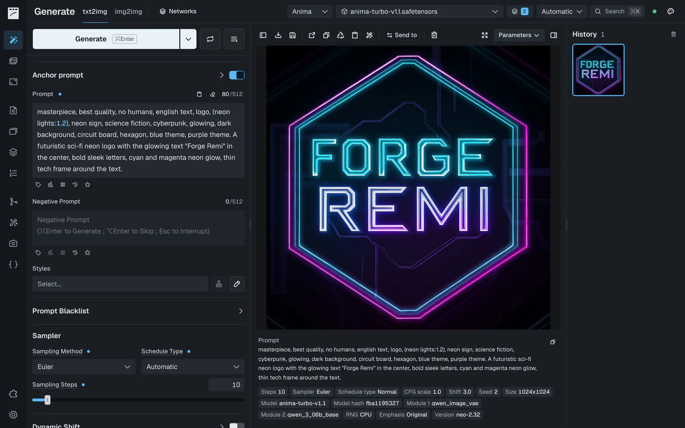
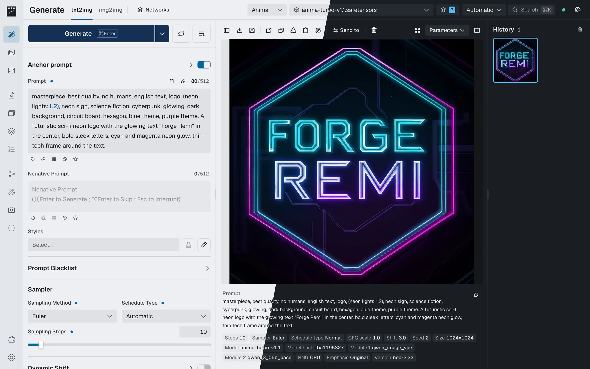
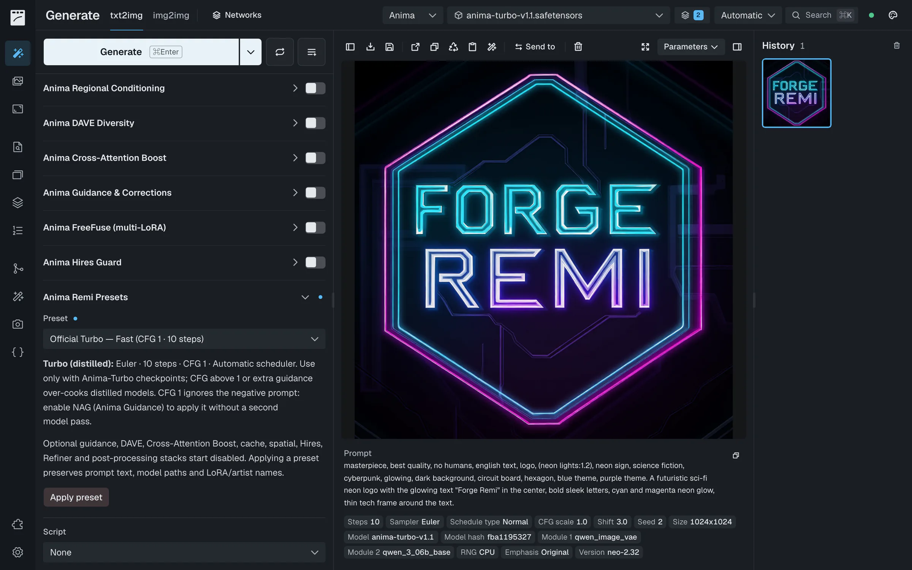
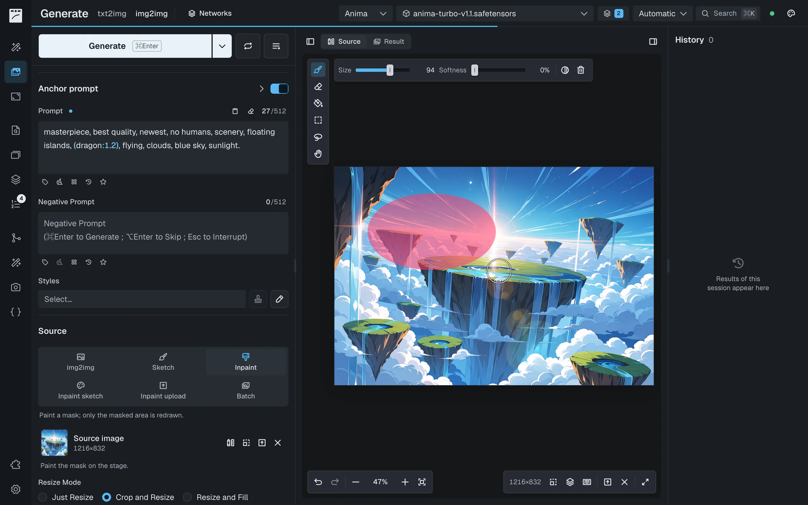
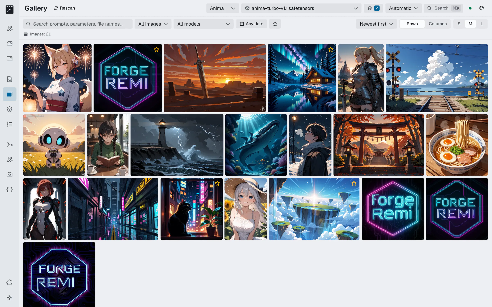
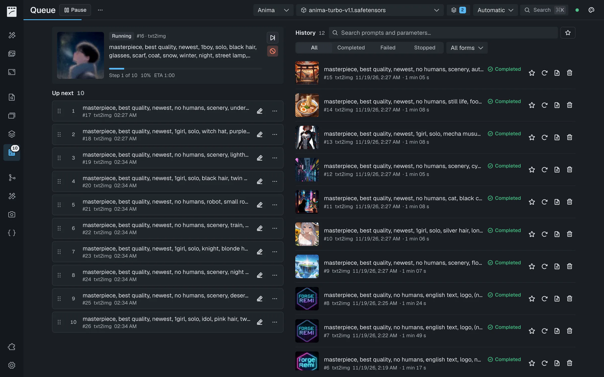
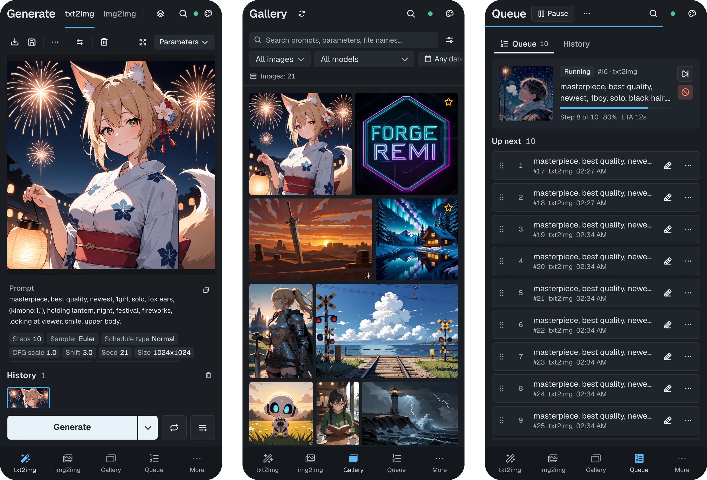

<div align="center">

# Forge Neo Remi

**An Anima-first, batteries-included distribution of Stable Diffusion WebUI Forge Neo, with its own fast, Gradio-free web interface.**

[English](README.md) | [简体中文](README.zh-CN.md)

[](LICENSE)
[](https://www.python.org/)
[](https://github.com/beautifulrem/forge-neo-remi/tree/remi)
[](https://github.com/Haoming02/sd-webui-forge-classic/tree/neo)



</div>

Forge Neo Remi is a downstream distribution of [Forge Neo](https://github.com/Haoming02/sd-webui-forge-classic/tree/neo), itself built on [Stable Diffusion WebUI Forge](https://github.com/lllyasviel/stable-diffusion-webui-forge) and [AUTOMATIC1111 WebUI](https://github.com/AUTOMATIC1111/stable-diffusion-webui). It keeps Forge Neo's generation engine and model support, adds a curated Anima generation stack with conflict-aware controls, and replaces the Gradio interface with a new web application: a FastAPI server, a persistent job queue and a React single-page app.

> [!IMPORTANT]
> This is an independent downstream branch, not an official release of Forge Neo or the Anima model. Remi favors integrated, tested workflows over compatibility with every third-party extension: extensions written for the old Gradio UI must be ported (see [Migrating from the Gradio UI](docs/remi-webui/usage.md#migrating-from-the-gradio-ui)).

## Why Remi?

- **A new web interface.** One app with a navigation rail instead of Gradio tabs: a three-pane Generate view, a real image editor, a gallery, a networks browser and a queue; light and dark themes, phone layouts, full keyboard operation, and English / 简体中文 switchable without a reload.
- **One queue for everything.** Every generation is a job in a persistent queue that survives restarts; queue, reorder, prioritize, edit and repeat jobs from the UI or the API.
- **Anima-first inference.** Native samplers, guidance methods, spatial conditioning, LoRA controls, Hires safeguards and acceleration paths ([what is included](docs/remi-webui/usage.md#anima-integration)).
- **The whole Anima family.** 2B, 2.9B and 3.8B (with its Qwen3.5 semantic connector, run natively); LoRAs and ControlNet-LLLite models move between the 28/40/52-block depths, and the Anima-Control-Pose control-LoRA runs as a ControlNet unit ([details](docs/remi-webui/usage.md#anima-29b-and-38b-checkpoints)).
- **Conflict-aware UI and runtime.** Mutually exclusive features are locked or resolved before they can form undefined sampling stacks, in the browser and for API jobs alike.
- **One-click safe baseline.** **Anima Remi Presets** provides a conservative starting profile without replacing prompts, LoRA names or model paths.
- **Batteries included.** Frequently used extensions ship as [built-ins](docs/remi-webui/usage.md#built-in-extensions), ported to the new UI.

## Screenshots

| | |
| --- | --- |
|  |  |
| Light and dark themes, three resizable panes | Anima Remi Presets and the Anima panels |
|  |  |
| The image editor: inpaint masks, sketch layers, selections | The gallery: search, filters, stars, compare |
|  |  |
| The queue: live preview, reorder, priorities, history | Phone layouts: Generate, Gallery and Queue |

The [usage guide](docs/remi-webui/usage.md#the-remi-webui) describes every page.

## Quick Start

You need [Git](https://git-scm.com/downloads), [Python 3.13](https://www.python.org/downloads/) or [uv](https://docs.astral.sh/uv/), a PyTorch device (an NVIDIA GPU is the most widely tested; Apple Silicon works through MPS) and [Node.js](https://nodejs.org/) 20.19+ or 22.12+ to build the web interface.

```bash
git clone --branch remi https://github.com/beautifulrem/forge-neo-remi.git forge-neo-remi
cd forge-neo-remi
```

Then run `./webui.sh` on Linux and macOS, or `webui-user.bat` on Windows.

The first launch installs the Python packages, builds the web interface and prints `Running on local URL:  http://127.0.0.1:7860/`. Put checkpoints, VAEs and text encoders in the matching `models/` subfolders, then pick them in the model bar.

For a first Anima image, open the **Anima Remi Presets** panel in the Generate view and apply **Official Base/Aesthetic — Safe (Recommended)**, or **Official Turbo — Fast (CFG 1 · 10 steps)** for an Anima-Turbo checkpoint.

The usage guide has the rest: [installation in detail](docs/remi-webui/usage.md#quick-start) (`uv`, machines without Node.js, Docker), [launch options](docs/remi-webui/usage.md#launch-options), [where data is stored](docs/remi-webui/usage.md#where-data-is-stored), [keyboard shortcuts](docs/remi-webui/usage.md#keyboard-shortcuts), [security and remote access](docs/remi-webui/usage.md#security-and-remote-access) and [troubleshooting](docs/remi-webui/usage.md#troubleshooting).

## Supported Model Families

Remi retains Forge Neo's modern-model focus and adds deeper Anima integration.

- Anima and Anima Edit: 2B (28 blocks), 2.9B (40) and 3.8B (52) checkpoints (3.8B with its `qwen35_4b` text encoder, [details](docs/remi-webui/usage.md#anima-29b-and-38b-checkpoints))
- SD 1.x and advanced SDXL variants
- Krea 2 and Krea 2 Identity Edit
- FLUX.3 Image Klein (Base and step-distilled; multi-reference editing; BFL / ComfyUI single files, Diffusers folders, FP8 / INT8 packages and GGUF; layout prompts from the JSON Builder page)
- FLUX Kontext and FLUX.2 Klein
- Qwen-Image, Qwen-Image-Edit and Qwen-Image-2.1 (Base and 8-step Turbo; Diffusers folders, Unsloth FP8 / INT8-ConvRot and GGUF; lossless cross-step prefix KV cache, bidirectional fused/unfused MLP LoRA mapping, `Qwen-2.1 per-block` compile, Spectrum pre-head forecasting, native 4-channel RGBA transparent generation and mask editing)
- Moss-Image and Moss-Image-Edit, with a [JSON Builder page](docs/remi-webui/usage.md) for MOSS-Image structured prompts
- Anima RGBA (transparent images; needs its [LoRA and VAE](https://huggingface.co/localai0301/Anima-RGBA); for img2img of a transparent image set `img2img_background_color` to `(255, 255, 255)`)
- GGUF checkpoints and text encoders (the `gguf` package, with Triton K-quant dequantization where available); GGUF-native layers keep their quantized weights when a checkpoint's state dict is (re)loaded, ordinary layers dequantize on load
- Ernie-Image, PiD 1.5, Z-Image, Mugen, Lumina Image 2, and Chroma
- Wan 2.2 image/video workflows

Use the upstream [model download guide](https://github.com/Haoming02/sd-webui-forge-classic/wiki/Download-Models) for checkpoint, VAE and text-encoder layouts.

## Documentation

- [Usage guide](docs/remi-webui/usage.md): every page, the Anima integration, installation, launch options, data, shortcuts, migration from the Gradio UI, built-in extensions, security, troubleshooting, compatibility notes
- [Remi Anima generation and parameter guide](docs/remi-anima-generation-guide.zh-CN.md) (zh-CN)
- [API guide (REST, WebSocket, /sdapi)](docs/remi-webui/api.md)
- [Extension developer guide](docs/remi-webui/extension-guide.md)
- [Security](docs/remi-webui/security.md) and [Docker](docker/README.md)
- [WebUI architecture](docs/remi-webui/architecture.md) and [Anima feature seams](docs/remi-architecture-notes.md)
- [Absorbing Forge Neo updates](docs/remi-webui/upstream-absorption.md)
- [Anima generation optimization research](docs/research/anima-generation-optimizations.md)
- [Documentation index](docs/remi-webui/README.md)
- [Forge Neo Wiki](https://github.com/Haoming02/sd-webui-forge-classic/wiki) · [Model downloads](https://github.com/Haoming02/sd-webui-forge-classic/wiki/Download-Models) · [Inference references](https://github.com/Haoming02/sd-webui-forge-classic/wiki/Inference-References)

## Issues and Contributions

Before opening an issue, reproduce it on the current `remi` branch with third-party extensions disabled. Include:

- Remi commit hash
- Operating system, browser, GPU/backend, Python and PyTorch versions
- Checkpoint family and quantization format
- Launch arguments and relevant generation parameters
- Full console traceback, the browser console for interface problems, or a minimal reproduction

Use the [Remi issue tracker](https://github.com/beautifulrem/forge-neo-remi/issues) for Remi-specific behavior. Upstream-only issues should be reproduced against [Forge Neo](https://github.com/Haoming02/sd-webui-forge-classic/tree/neo) before being reported there.

Contributions should keep features isolated, preserve non-Anima behavior, add regression coverage for shared sampling/model-loading paths, and document GUI/runtime conflict semantics. `tools/check.sh` runs every check (Python and frontend tests, lint, types, build).

## Upstream and Acknowledgements

Remi builds on the work of [AUTOMATIC1111](https://github.com/AUTOMATIC1111/stable-diffusion-webui), [lllyasviel](https://github.com/lllyasviel/stable-diffusion-webui-forge), [Haoming02](https://github.com/Haoming02/sd-webui-forge-classic), [ComfyUI](https://github.com/Comfy-Org/ComfyUI), and the authors of the bundled extensions and algorithms. Their original licenses and notices remain with their respective components.

## License

The main project is licensed under the [GNU Affero General Public License v3.0](LICENSE). Bundled extensions and vendored components may carry additional compatible licenses; consult the `LICENSE` files in their directories.
