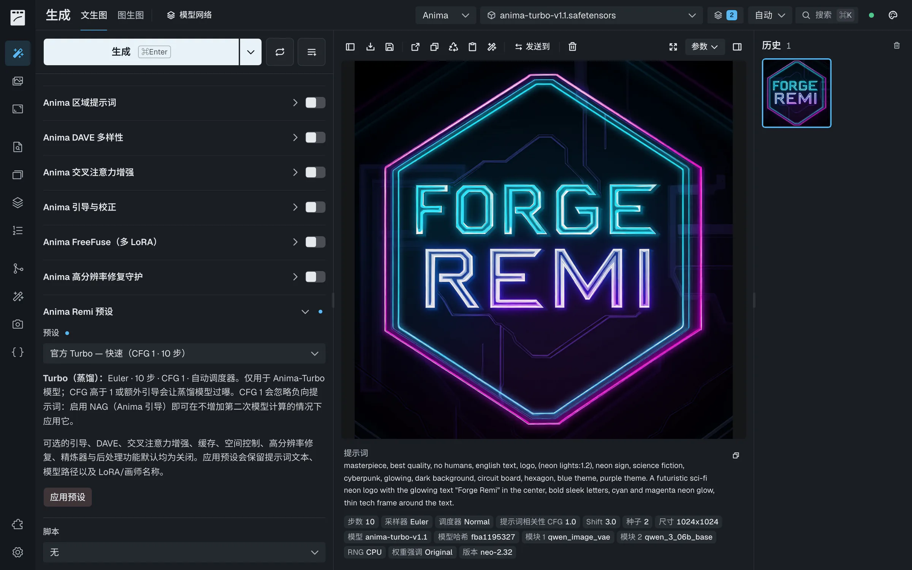

<div align="center">

# Forge Neo Remi

**基于 Stable Diffusion WebUI Forge Neo 的零节点、冲突安全、专业工作室级 AI 图像创作工作台 —— 以 Anima 为先、覆盖现代多族 DiT、彻底移除 Gradio（FastAPI + React 19 单页应用）。**

[English](README.md) | [简体中文](README.zh-CN.md)

[](LICENSE)
[](https://www.python.org/)
[](https://github.com/beautifulrem/forge-neo-remi/tree/remi)
[](https://github.com/Haoming02/sd-webui-forge-classic/tree/neo)


</div>

Forge Neo Remi 是 [Forge Neo](https://github.com/Haoming02/sd-webui-forge-classic/tree/neo) 的下游发行分支，而 Forge Neo 建立在 [Stable Diffusion WebUI Forge](https://github.com/lllyasviel/stable-diffusion-webui-forge) 和 [AUTOMATIC1111 WebUI](https://github.com/AUTOMATIC1111/stable-diffusion-webui) 之上。Remi 不是节点图编辑器，也不是新的基础模型：它面向 8–24 GB 消费级 GPU 与 Apple Silicon 统一内存，将 Forge Neo 的推理引擎与现代 DiT 模型栈，与无 Gradio 的现代创作工作台（FastAPI + SQLite 持久队列 + React 19 SPA）、能力驱动的声明式参数层（`remi.ui` v1）、非节点可组合工作流及深度 Anima 集成融为一体。

> [!IMPORTANT]
> 这是独立的下游分支，不是 Forge Neo 或任何模型家族的官方发行版。Remi 优先保障集成工作流的冲突安全与可验证性，不承诺兼容所有旧版第三方扩展：为旧 Gradio 界面编写的扩展需要移植至 `remi.ui`（见[从 Gradio 界面迁移](docs/remi-webui/usage.zh-CN.md#从-gradio-界面迁移)）。

## 为什么选择 Remi

- **工作室级界面与能力驱动的生成页。** 无需 Gradio 的 React 19 单页应用，内置精致浅色/深色主题、手机布局、完整键盘操控与无刷新 English / 简体中文切换。`ModelCapability` 自动收纳不适用于当前模型的扩展面板（并给出原因）、在模型栏展示格式与能力徽章（`Diffusers`、`GGUF`、`INT8-ConvRot`、`FP8`、`NVFP4`、`Turbo`、`RGBA`、`Control`），并在提交前提供可一键修正参数的**工作流建议**芯片。
- **非节点可组合工作流（Recipes 与线性多阶段管线）。** 支持跨模型保存、分享与应用冲突安全校验的 **Recipes（参数配方）**，以及**线性多阶段管线**（`提示词扩写 → 生成 → 精修 → 后处理`）与基于内容哈希的上游阶段缓存——调整后段精修或放大参数重跑时自动复用前段已生成产物，无需手搭节点图。
- **端到端图像创作闭环。** 内置**图库看板（Boards）**、父子**资产血缘（Lineage）**追踪、像素滑块 + 结构化**参数 Diff 对比**、**查看器 RGBA 四色底板**切换（快捷键 `B`）、一键**发送到参考图**及模型感知槽位标记（`<image_1>`、`ref_image_0`、`ref_0`）、**画布原地 Staging** 局部重绘候选审阅、支持多模态参考图/BBox 与本地量化的**提示词扩写（PUP）**，以及支持 MOSS-Image、FLUX.3 布局与 Bria Fibo 2.0 VGL 2.0 的 **JSON Builder**。
- **Anima 深度护城河与冲突安全运行时。** 完整覆盖 Anima 2B / 2.9B / 3.8B（28/40/52 层与原生 Qwen3.5 语义连接器）、跨深度 LoRA 与 ControlNet-LLLite 重映射、Control-LoRA / VACE、原生采样器、引导、空间控制与 **Anima Remi 预设**安全基线；互斥功能在浏览器和 API 任务中均会在采样前锁定或解析（[详见 Anima 集成](docs/remi-webui/usage.zh-CN.md#anima-集成)）。
- **Worker 进程隔离、多 GPU 池与 Apple Silicon 优化。** 默认向后兼容进程内模式，同时通过 `WorkerProtocol` 提供按需隔离后端：`--worker-process`（独立子进程崩溃/OOM 自愈并消除界面/WebSocket 的 GIL 争用）、`--worker-gpus 0,1`（本机多 GPU Worker 池）与 `--worker-mlx`（可选 Apple Silicon MLX / `mflux` Sidecar）。这几个参数目前是预览：Worker 会出现在 Workers 监控里，但队列不会把任务派给它们，仍在进程内执行所有任务。内置 Apple Silicon MPS 反量化权重缓存、统一内存预算感知及可复现跨平台基准套件 `tools/perf/bench_inference.py`。
- **稳定的扩展 API v1 与上游分叉治理。** 显式声明 `REMI_API_VERSION = "1.0"`、可选 `remi-extension.json` 清单、扩展页面**健康诊断**（加载耗时、hook/action 错误与超时统计）、公开契约验证工具包 `remi.testing`，以及自动化上游分叉债预算门禁（`tools/upstream_forks.py budget`，硬约束 `FORKED <= 6`）。
- **常用能力开箱即用。** 高频扩展已作为[内置扩展](docs/remi-webui/usage.zh-CN.md#内置扩展)移植到 `remi.ui`，并由 Python、Vitest 与 Playwright + axe 自动化门禁持续守护。

## 界面截图

| | |
| --- | --- |
|  |  |
| 浅色与深色主题，三栏可调整宽度 | Anima Remi 预设与能力驱动面板 |
|  |  |
| 图像编辑器：蒙版、涂鸦图层、选区与原地 Staging | 图库：看板、血缘、搜索、星标与参数 Diff 对比 |
|  |  |
| 队列：实时预览、优先级、线性管线与配方 | 手机布局：生成、图库与队列 |

[使用指南](docs/remi-webui/usage.zh-CN.md#remi-webui-界面)逐页介绍了全部界面与工作流。

## 快速开始

需要 [Git](https://git-scm.com/downloads)、[Python 3.13](https://www.python.org/downloads/) 或 [uv](https://docs.astral.sh/uv/)、受支持的 PyTorch 设备（NVIDIA GPU 测试最充分；Apple Silicon 可通过 MPS 运行），以及用于构建网页界面的 [Node.js](https://nodejs.org/) 22.18+ 或 24.11+。

```bash
git clone --branch remi https://github.com/beautifulrem/forge-neo-remi.git forge-neo-remi
cd forge-neo-remi
```

然后在 Linux 和 macOS 上运行 `./webui.sh`，在 Windows 上运行 `webui-user.bat`。

首次启动会自动安装 Python 依赖、构建 `webui/dist`，并输出 `Running on local URL:  http://127.0.0.1:7860/`。把 checkpoint、VAE 和文本编码器放入 `models/` 对应子目录后即可在模型栏中选择。如需启用独立子进程、多 GPU 或 MLX Sidecar，可在 `COMMANDLINE_ARGS` 或 `python launch.py` 中传入 `--worker-process`、`--worker-gpus 0,1` 或 `--worker-mlx`。

首次生成 Anima 图像时，在生成页打开 **Anima Remi 预设**面板，应用 **官方 Base/Aesthetic — 稳妥（推荐）**；Anima-Turbo checkpoint 请应用 **官方 Turbo — 快速（CFG 1 · 10 步）**。

更多内容见使用指南：[详细安装说明](docs/remi-webui/usage.zh-CN.md#快速开始)（`uv`、无 Node.js 环境、Docker）、[启动参数](docs/remi-webui/usage.zh-CN.md#启动参数)、[数据存储位置](docs/remi-webui/usage.zh-CN.md#数据存储位置)、[键盘快捷键](docs/remi-webui/usage.zh-CN.md#键盘快捷键)、[安全与远程访问](docs/remi-webui/usage.zh-CN.md#安全与远程访问)和[故障排查](docs/remi-webui/usage.zh-CN.md#故障排查)。

## 支持的模型家族

Remi 保留 Forge Neo 的现代模型运行时，并通过全栈能力层深度增强多族 Tier-1 / Tier-2 DiT 模型（[模型与加速细节](docs/remi-webui/usage.zh-CN.md#dit-模型家族controlnet-union-与推理加速)）：

- **Anima 与 Anima Edit：** 2B（28 层）、2.9B（40 层）与 3.8B（52 层，原生支持 `qwen35_4b` 语义连接器），跨深度 LoRA / ControlNet-LLLite 重映射、Control-LoRA / VACE，以及 **Anima RGBA**（[详见](docs/remi-webui/usage.zh-CN.md#anima-29b-与-38b-checkpoint)；Anima RGBA 需配套其 [LoRA 与 VAE](https://huggingface.co/localai0301/Anima-RGBA)）
- **Qwen-Image、Qwen-Image-Edit 与 Qwen-Image-2.1：** Base 与 8 步 Turbo；支持 Diffusers 目录、Unsloth FP8 / INT8-ConvRot 与 GGUF；跨步零损前缀 KV 缓存、融合/拆分 MLP 双向 LoRA 映射、`Qwen-2.1 per-block` 逐块编译、Spectrum 预测、原生 4 通道 RGBA 透明出图与蒙版编辑，以及基于统一 `DiTControlPatch` 的 **`Qwen-Image-2.1-Fun-Controlnet-Union`**
- **FLUX.3 Image Klein：** Base 与步数蒸馏版；多参考图编辑（`ref_image_{i}` 槽位）；支持 BFL / ComfyUI 单文件、Diffusers、FP8 / INT8 与 GGUF；内置**多模态/本地 PUP 扩写**与 JSON Builder BBox 布局 —— 同时支持 **FLUX Kontext** 和 **FLUX.2 Klein**
- **Z-Image（Base / Turbo / Omni / Edit）：** Diffusers/分片加载、敏感层量化保护、跨步文本/RoPE 缓存、逐块编译、Spectrum 接缝与 **`Z-Image-Turbo-Fun-Controlnet-Union`**
- **MOSS-Image、MOSS-Image-Edit 与 Kromoss：** 配套 JSON Builder 结构化排版与原生 **8 步 DMD2 LoRA** 工作流建议
- **Krea 2 与 Krea 2 Identity Edit：** 步不变文本/参考/RoPE 缓存、SLG 挂接与 Spectrum 接缝
- **ERNIE-Image（8B，Apache 2.0）：** Diffusers/分片加载、敏感层量化保护与能力驱动默认参数
- **Bria Fibo 2.0（8.1B Dev 与 4 步 Edit Turbo）：** 集成 JSON Builder 与 PUP 的 **VGL 2.0 结构化 JSON** 模式（*注：Bria Fibo 2.0 权重采用 CC BY-NC 4.0 许可，仅限非商业用途*）
- **经典与视频/辅助模型：** SD 1.x、高级 SDXL 变体、PiD 1.5、Mugen、Lumina Image 2、Chroma 与 Wan 2.2 图像/视频工作流
- **量化与加速栈：** **GGUF** checkpoint 与文本编码器（可用时以 Triton 反量化 K-quant；GGUF 原生层在重载时保持量化权重）、**FP8**（含 Anima scaled FP8）、**INT8-ConvRot**、**NVFP4**、**SVDQuant**、逐块 `torch.compile`，以及 **Spectrum** 预测（**Chebyshev**，外加可选 **TaylorSeer** 与 **MagCache** 模式）

checkpoint、VAE 和文本编码器的目录规范请参考上游[模型下载指南](https://github.com/Haoming02/sd-webui-forge-classic/wiki/Download-Models)。

## 文档

- [使用指南](docs/remi-webui/usage.zh-CN.md)：每个页面、Anima 与 DiT 集成、安装、启动与 Worker 参数、数据、快捷键、从 Gradio 迁移、内置扩展、安全、故障排查、兼容性说明
- [Remi Anima 生成与参数指南](docs/remi-anima-generation-guide.zh-CN.md)
- [API 指南（REST `/api/v2`、WebSocket、`/sdapi/v1`）](docs/remi-webui/api.md)
- [扩展开发指南（`remi.ui` v1、Manifest、`remi.testing`）](docs/remi-webui/extension-guide.md)
- [安全](docs/remi-webui/security.md)与 [Docker](docker/README.md)
- [WebUI 架构](docs/remi-webui/architecture.md)与 [Anima 功能接入点](docs/remi-architecture-notes.md)
- [吸收 Forge Neo 更新](docs/remi-webui/upstream-absorption.md)与[上游 PR 减债路线图及代码精简审计](docs/remi-webui/upstream-pr-candidates.md)
- [推理与显存性能基准](docs/research/inference-performance.md)及 [UI 性能实测报告](docs/research/ui-performance.md)
- [2026 Q4–2027 Q2 演进路线图](docs/research/roadmap-2026-q4.zh-CN.md)、[竞品与架构深度调研](docs/research/competitive-and-architecture-research-2026-11.zh-CN.md)及 [Anima 生成优化调研](docs/research/anima-generation-optimizations.md)
- [文档索引](docs/remi-webui/README.md)
- [Forge Neo Wiki](https://github.com/Haoming02/sd-webui-forge-classic/wiki) · [模型下载](https://github.com/Haoming02/sd-webui-forge-classic/wiki/Download-Models) · [推理参考](https://github.com/Haoming02/sd-webui-forge-classic/wiki/Inference-References)

（部分开发者与性能报告文档目前为英文。）

## 问题反馈与贡献

提交问题前，请在当前 `remi` 分支上复现，并禁用第三方扩展。请附带：

- Remi commit hash
- 操作系统、浏览器、GPU/后端、Python 和 PyTorch 版本
- checkpoint 家族与量化格式
- 启动参数（含任意 `--worker-*` 参数）和相关生成参数
- 完整控制台 traceback、界面问题的浏览器控制台输出，或最小复现

Remi 特有问题请提交到 [Remi Issues](https://github.com/beautifulrem/forge-neo-remi/issues)。仅与上游有关的问题，请先在 [Forge Neo](https://github.com/Haoming02/sd-webui-forge-classic/tree/neo) 中复现后再向上游反馈。

贡献代码时请通过 `ModelCapability` / `remi.ui` 声明模型能力，保持共享运行时改动最小化（`python tools/upstream_forks.py budget` 强制执行 `FORKED <= 6`），保留上游 CRLF 换行符（`tools/check_line_endings.py`），并补充回归测试。`tools/check.sh` 会运行全部 Python、契约、i18n、包体积预算、lint、Vitest 与 Playwright + axe 检查。

## 上游与致谢

Remi 建立在 [AUTOMATIC1111](https://github.com/AUTOMATIC1111/stable-diffusion-webui)、[lllyasviel](https://github.com/lllyasviel/stable-diffusion-webui-forge)、[Haoming02](https://github.com/Haoming02/sd-webui-forge-classic)、[ComfyUI](https://github.com/Comfy-Org/ComfyUI) 以及内置扩展和算法作者的工作之上。原始许可证和声明保留在各自组件中；设置 → 许可证列出了它们，并链接到网页界面构建产出的 `THIRD-PARTY-NOTICES.txt`（其包含的每个库及其许可证全文；`webui/tools/notices.mjs`）。

## 许可证

主项目采用 [GNU Affero General Public License v3.0](LICENSE)。内置扩展、vendored 组件及第三方模型权重（例如采用 CC BY-NC 4.0 许可的 Bria Fibo 2.0）均附带各自许可证，使用前请查阅对应目录的 `LICENSE` 文件与模型卡。

网页界面会向用户提供正在运行的服务器的源代码（AGPL-3.0 第 13 条）：登录界面、设置 → 许可证和设置 → 服务器与模型都有链接。如果你运行修改过的副本并让他人通过网络使用，请公开你的源代码，并用 `--source-url` 指向它启动服务器。详见 [docs/remi-webui/licensing.md](docs/remi-webui/licensing.md)，其中也列出了没有自带许可证文件的内置扩展的来源与许可证。
