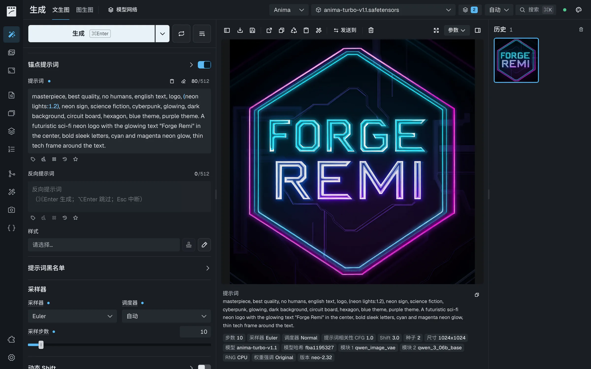
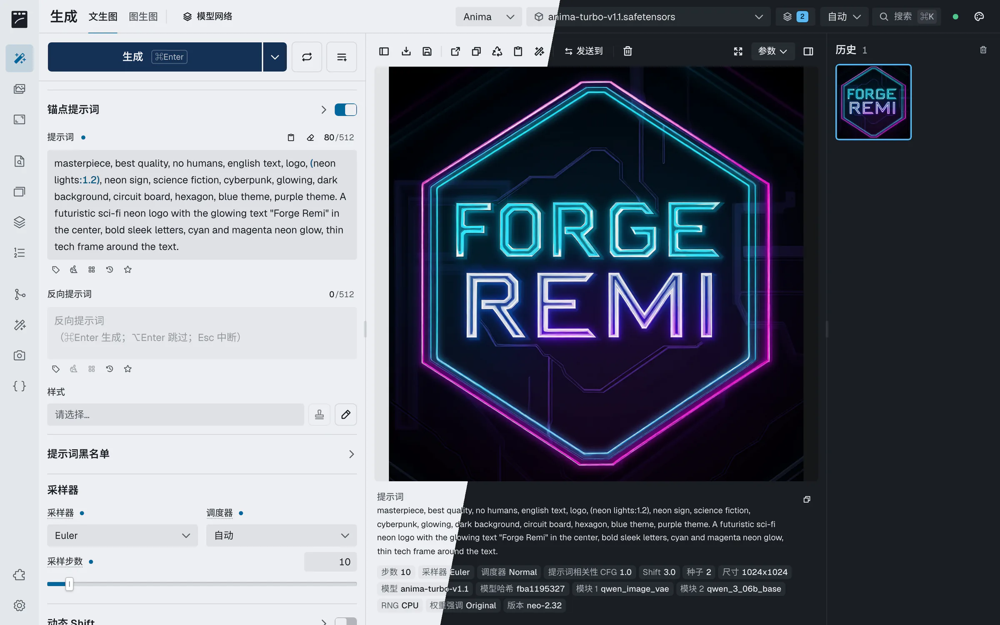
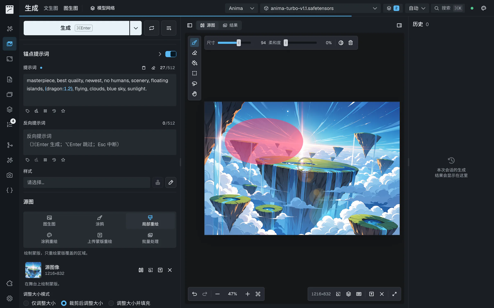
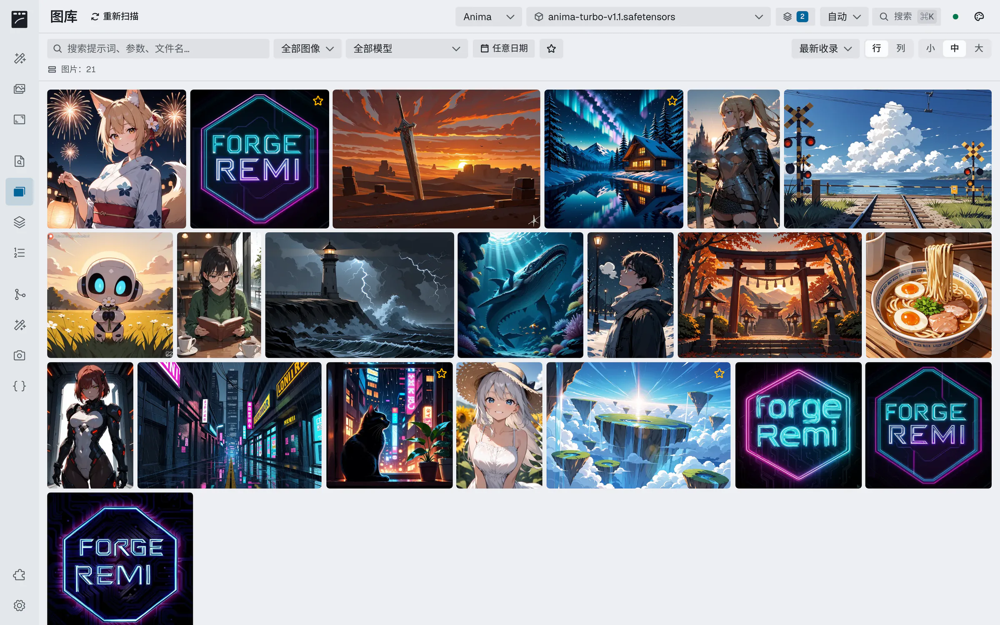
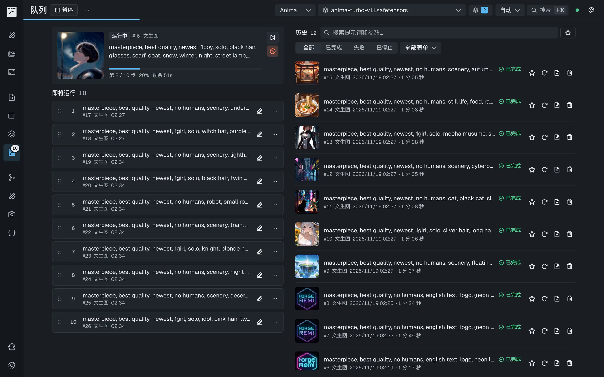
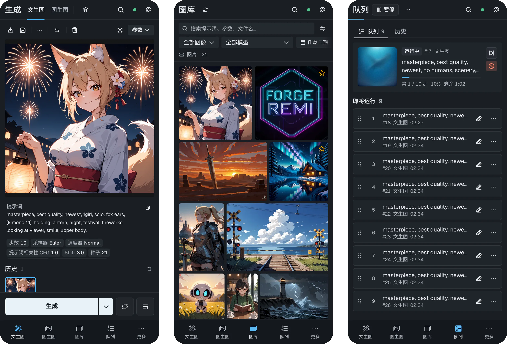

<div align="center">

# Forge Neo Remi

**一个以 Anima 为重点、开箱即用的 Stable Diffusion WebUI Forge Neo 发行分支，配备独立、快速、不依赖 Gradio 的网页界面。**

[English](README.md) | [简体中文](README.zh-CN.md)

[](LICENSE)
[](https://www.python.org/)
[](https://github.com/beautifulrem/forge-neo-remi/tree/remi)
[](https://github.com/Haoming02/sd-webui-forge-classic/tree/neo)




</div>

Forge Neo Remi 是 [Forge Neo](https://github.com/Haoming02/sd-webui-forge-classic/tree/neo) 的下游发行分支，而 Forge Neo 建立在 [Stable Diffusion WebUI Forge](https://github.com/lllyasviel/stable-diffusion-webui-forge) 和 [AUTOMATIC1111 WebUI](https://github.com/AUTOMATIC1111/stable-diffusion-webui) 之上。Remi 保留 Forge Neo 的生成引擎与模型支持，集成经筛选的 Anima 生成技术和冲突感知控件，并用全新的网页应用取代了 Gradio 界面：FastAPI 服务器、持久化任务队列和 React 单页应用。

> [!IMPORTANT]
> 这是独立的下游分支，不是 Forge Neo 或 Anima 模型的官方发行版。Remi 优先保证集成工作流的可用性和可验证性，不承诺兼容所有第三方扩展：为旧 Gradio 界面编写的扩展需要移植（见[从 Gradio 界面迁移](docs/remi-webui/usage.zh-CN.md#从-gradio-界面迁移)）。

## 为什么选择 Remi

- **全新的网页界面。** 用侧边导航栏取代 Gradio 标签页：三栏式生成页、真正的图像编辑器、图库、模型网络浏览器和任务队列；支持浅色与深色主题、手机布局、完整的键盘操作，English / 简体中文无需刷新即可切换。
- **所有生成共用一个队列。** 每次生成都是持久化队列中的一个任务，重启后仍在；可在界面或 API 中排队、调整顺序、设置优先级、编辑和重复任务。
- **Anima 优先推理：** 内置采样器、引导方法、空间控制、LoRA 管理、高分辨率保护和加速路径（[包含的功能](docs/remi-webui/usage.zh-CN.md#anima-集成)）。
- **完整的 Anima 系列：** 支持 2B、2.9B 和 3.8B（原生运行其 Qwen3.5 语义连接器）；LoRA 和 ControlNet-LLLite 模型可在 28/40/52 层之间通用，Anima-Control-Pose 的 control-LoRA 可作为 ControlNet 单元使用（[细节](docs/remi-webui/usage.zh-CN.md#anima-29b-与-38b-checkpoint)）。
- **界面与运行时冲突管理：** 互斥功能会在组成未定义采样链之前被锁定或自动解决，浏览器中和 API 任务都一样。
- **一键安全基线：** **Anima Remi 预设** 提供保守的推荐起点，不会覆盖提示词、LoRA 名称或模型路径。
- **常用功能内置：** 常用扩展作为[内置扩展](docs/remi-webui/usage.zh-CN.md#内置扩展)随 Remi 发布，并已移植到新界面。

## 界面截图

| | |
| --- | --- |
|  |  |
| 浅色与深色主题，三栏可调整宽度 | Anima Remi 预设与各 Anima 面板 |
|  |  |
| 图像编辑器：重绘蒙版、涂鸦图层、选区 | 图库：搜索、筛选、星标、对比 |
|  |  |
| 队列：实时预览、调整顺序、优先级、历史 | 手机布局：生成、图库与队列 |

[使用指南](docs/remi-webui/usage.zh-CN.md#remi-webui-界面)逐页介绍了界面。

## 快速开始

需要 [Git](https://git-scm.com/downloads)、[Python 3.13](https://www.python.org/downloads/) 或 [uv](https://docs.astral.sh/uv/)、受支持的 PyTorch 设备（NVIDIA GPU 是测试最充分的选择；Apple Silicon 可通过 MPS 运行），以及用于构建网页界面的 [Node.js](https://nodejs.org/) 20.19+ 或 22.12+。

```bash
git clone --branch remi https://github.com/beautifulrem/forge-neo-remi.git forge-neo-remi
cd forge-neo-remi
```

然后在 Linux 和 macOS 上运行 `./webui.sh`，在 Windows 上运行 `webui-user.bat`。

首次启动会安装 Python 依赖、构建网页界面，并输出 `Running on local URL:  http://127.0.0.1:7860/`。把 checkpoint、VAE 和文本编码器放进 `models/` 中对应的子目录，然后在模型栏中选择。

第一次生成 Anima 图像时，在生成页中打开 **Anima Remi 预设** 面板，应用 **官方 Base/Aesthetic — 稳妥（推荐）**；Anima-Turbo checkpoint 请应用 **官方 Turbo — 快速（CFG 1 · 10 步）**。

其余内容见使用指南：[详细安装说明](docs/remi-webui/usage.zh-CN.md#快速开始)（`uv`、没有 Node.js 的机器、Docker）、[启动参数](docs/remi-webui/usage.zh-CN.md#启动参数)、[数据存储位置](docs/remi-webui/usage.zh-CN.md#数据存储位置)、[键盘快捷键](docs/remi-webui/usage.zh-CN.md#键盘快捷键)、[安全与远程访问](docs/remi-webui/usage.zh-CN.md#安全与远程访问)和[故障排查](docs/remi-webui/usage.zh-CN.md#故障排查)。

## 支持的模型家族

Remi 保留 Forge Neo 对现代模型的支持重点，并对 Anima 提供更深入的集成。

- Anima 和 Anima Edit：2B（28 层）、2.9B（40 层）与 3.8B（52 层）checkpoint（3.8B 需另备 `qwen35_4b` 文本编码器，[细节](docs/remi-webui/usage.zh-CN.md#anima-29b-与-38b-checkpoint)）
- SD 1.x 和高级 SDXL 变体
- Krea 2 和 Krea 2 Identity Edit
- FLUX Kontext 和 FLUX.2 Klein
- Qwen-Image、Qwen-Image-Edit 和 Qwen-Image-2.1
- Moss-Image 和 Moss-Image-Edit，配套 [JSON Builder 页面](docs/remi-webui/usage.zh-CN.md)用于编写 MOSS-Image 结构化提示词
- Anima RGBA（透明图像；需要其 [LoRA 与 VAE](https://huggingface.co/localai0301/Anima-RGBA)；对透明图做图生图时请把 `img2img_background_color` 设为 `(255, 255, 255)`）
- GGUF checkpoint 与文本编码器（使用 `gguf` 包，可用时以 Triton 反量化 K-quant）；GGUF 原生层在（重复）加载 state dict 时保持量化权重，普通层在加载时反量化
- Ernie-Image、PiD 1.5、Z-Image、Mugen、Lumina Image 2 和 Chroma
- Wan 2.2 图像/视频工作流

checkpoint、VAE 和文本编码器的放置方式请参考上游[模型下载指南](https://github.com/Haoming02/sd-webui-forge-classic/wiki/Download-Models)。

## 文档

- [使用指南](docs/remi-webui/usage.zh-CN.md)：每个页面、Anima 集成、安装、启动参数、数据、快捷键、从 Gradio 界面迁移、内置扩展、安全、故障排查、兼容性说明
- [Remi Anima 生成与参数指南](docs/remi-anima-generation-guide.zh-CN.md)
- [API 指南（REST、WebSocket、/sdapi）](docs/remi-webui/api.md)
- [扩展开发指南](docs/remi-webui/extension-guide.md)
- [安全](docs/remi-webui/security.md)与 [Docker](docker/README.md)
- [WebUI 架构](docs/remi-webui/architecture.md)与 [Anima 功能接入点](docs/remi-architecture-notes.md)
- [吸收 Forge Neo 更新](docs/remi-webui/upstream-absorption.md)
- [Anima 生成优化调研](docs/research/anima-generation-optimizations.md)
- [文档索引](docs/remi-webui/README.md)
- [Forge Neo Wiki](https://github.com/Haoming02/sd-webui-forge-classic/wiki) · [模型下载](https://github.com/Haoming02/sd-webui-forge-classic/wiki/Download-Models) · [推理参考](https://github.com/Haoming02/sd-webui-forge-classic/wiki/Inference-References)

（开发者文档目前为英文。）

## 问题反馈与贡献

提交问题前，请在当前 `remi` 分支上复现，并禁用第三方扩展。请附带：

- Remi commit hash
- 操作系统、浏览器、GPU/后端、Python 和 PyTorch 版本
- checkpoint 家族与量化格式
- 启动参数和相关生成参数
- 完整控制台 traceback、界面问题的浏览器控制台输出，或最小复现

Remi 特有问题请提交到 [Remi Issues](https://github.com/beautifulrem/forge-neo-remi/issues)。仅与上游有关的问题，请先在 [Forge Neo](https://github.com/Haoming02/sd-webui-forge-classic/tree/neo) 中复现后再向上游反馈。

贡献代码时请保持功能隔离，不改变非 Anima 行为；修改共享采样或模型加载路径时请增加回归测试，并记录界面与运行时的冲突语义。`tools/check.sh` 会运行全部检查（Python 与前端测试、lint、类型检查、构建）。

## 上游与致谢

Remi 建立在 [AUTOMATIC1111](https://github.com/AUTOMATIC1111/stable-diffusion-webui)、[lllyasviel](https://github.com/lllyasviel/stable-diffusion-webui-forge)、[Haoming02](https://github.com/Haoming02/sd-webui-forge-classic)、[ComfyUI](https://github.com/Comfy-Org/ComfyUI) 以及内置扩展和算法作者的工作之上。原始许可证和声明保留在各自组件中。

## 许可证

主项目采用 [GNU Affero General Public License v3.0](LICENSE)。内置扩展和 vendored 组件可能附带其他兼容许可证，请查阅对应目录中的 `LICENSE` 文件。
