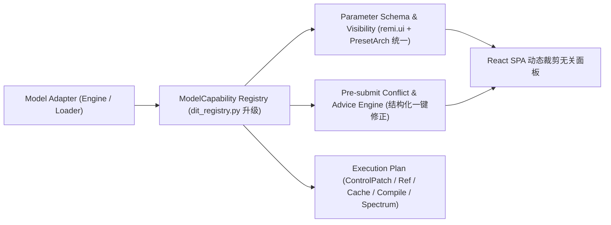
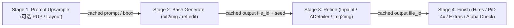
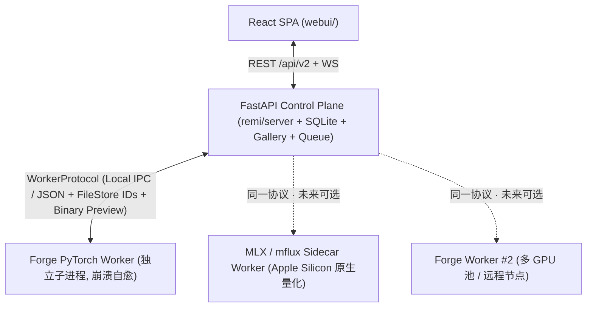

# Forge Neo Remi 竞品、架构与生态深度调研报告（2026-11）

> **调研基准日期**：2026-11-23  
> **代码基线**：`remi` 分支 `8b1b749e`（已合并 Forge Neo 2.33 `5998fb39`，落地 `DiTCapability` 注册表及 Anima / MOSS-Image / Krea 2 / FLUX.3 Image Klein / Qwen-Image-2.1 五大 Tier-1 引擎）  
> **配套路线图**：[roadmap-2026-q4.zh-CN.md](roadmap-2026-q4.zh-CN.md)（本文为其战略定位、竞品对标与代码级架构审计依据）

---

## 核心结论摘要

1. **竞争优势的本质不在推理引擎，而在「零节点专业工作台」产品形态**  
   2026 年底，开源生图工具格局已高度分化：ComfyUI 以 DAG 执行图、子图（Subgraphs）、局部重执行与庞大节点生态统治「任意流程编排」；InvokeAI 以 Unified Canvas、Control Layers、工程文件（`.invk`）与 Form Builder 确立「专业画布工作台」标杆；SwarmUI 以多 GPU 后端池和参数网格占据「批量调度前端」；SD.Next 以 Diffusers 原生后端覆盖最广模型长尾。  
   **Forge Neo Remi 真正的蓝海定位不是“另一个 ComfyUI”或“支持最多新模型的 Forge Neo 美化版”，而是：**
   > **「不需要搭节点、但拥有冲突安全保障与专业参数控制能力的现代图像创作工作台」**——让用户以传统 WebUI 的操作成本，获得接近专业创作工具的流程管理与阶段复用体验，同时保持 Anima 生态护城河与 8–24GB 消费级硬件 / Apple Silicon 本地优先优势。

2. **当前最大战略风险：模型特性持续堆砌，反噬核心架构可维护性**  
   对 `remi` 最近 20 次提交（`ed6cc223..8b1b749e`）和 `tools/upstream_forks.py` 的审计显示，近期开发重心高度向「接入新模型与模型专项补丁」倾斜，已导致上游分叉追踪清单膨胀至 **`FORKED` 6 处、`DIVERGED` 32 个文件、CRLF 兼容追踪 80 个文件**。若继续沿着「每出新模型就深度定制引擎」的单轨惯性推进，Remi 将迅速陷入高昂的上游合并债务，而真正能建立独立护城河的**性能实证基准、创作工作流闭环、能力驱动 UI、扩展 API 契约、Worker 进程隔离**反而长期缺位。

3. **代码级事实核验：Remi 的真实底牌比外界印象更强，但结构性短板同样真实**  
   - **已建立的硬实力**：无 Gradio 重构与 UI 性能预算**已经实测达标**（启动 4.37 s vs Gradio 12.02 s、5,000 LoRA / 10,000 图库 60–144 fps、UI 推理开销 ≤ 1%）；`remi.ui` 声明式参数契约、59 项自动化门禁（1,929+ Python 单测 / 1,345+ Vitest / 148+ Playwright e2e）与 `DiTCapability` 后端注册表已打下极高工程起点。
   - **经代码审计确认的五大结构性缺口**：
     1. **推理与显存性能缺乏跨平台实测基准**（UI 测得极细，但 GPU/MPS 推理、VRAM、模型切换耗时对照 ComfyUI / Forge Neo 为零）；
     2. **`DiTCapability` 仅完成后端半程，尚未驱动 `remi.ui` 与执行计划**（仅覆盖 5/17 引擎；10+ Anima 面板在非 Anima 模型下照常渲染；`modules/processing.py` 仍有 15 处 `dynamic_args.*` 分支；`PresetArch` 双轨分裂；`workflow_advice` 仅事后写日志）；
     3. **图库、对比、画布与任务队列尚未打通「非节点式创作与阶段复用闭环」**（`CompareDialog` 缺参数 Diff、Gallery 缺项目 Boards 与资产血缘树、Canvas 缺原地候选 Staging、`Send to` 缺一键入参考图、单 Job 架构无法支持“改后段参数复用前段产物”）；
     4. **`remi.ui` 扩展 API 缺少对外稳定化契约**（无 `REMI_API_VERSION`、无扩展 Manifest 与模型能力前置声明、缺少公开测试工具包与运行时诊断隔离）；
     5. **单进程主线程 Worker 架构存在扩展上限**（`JobQueue` 虽具依赖注入边界，但执行器仍直连进程内 `shared.state` 与 `main_thread`，导致崩溃/OOM 无法隔离、高负载下存在 15–32 ms/step GIL 争用，且阻断了 Apple Silicon 可选 MLX Sidecar 与多 GPU 演进）。

---

## 目录

- [一、2026 Q4 开源图像生成工作台竞品深度对标](#一2026-q4-开源图像生成工作台竞品深度对标)
  - [1.1 七大主流方案全景能力矩阵](#11-七大主流方案全景能力矩阵)
  - [1.2 关键竞品 2025–2026 演进态势与对 Remi 的启示](#12-关键竞品-20252026-演进态势与对-remi-的启示)
- [二、战略建议的逐项代码级核验（Fact-Check）](#二战略建议的逐项代码级核验fact-check)
- [三、Remi 仓库现状的五大资产与五大结构性短板（量化审计）](#三remi-仓库现状的五大资产与五大结构性短板量化审计)
  - [3.1 最值得作为长期资产固化的五大优势](#31-最值得作为长期资产固化的五大优势)
  - [3.2 经源码与数据审计确认的五大结构性短板](#32-经源码与数据审计确认的五大结构性短板)
- [四、2026 Q4 开源模型与底层推理技术生态精简评估](#四2026-q4-开源模型与底层推理技术生态精简评估)
  - [4.1 开源模型格局矩阵与分层策略](#41-开源模型格局矩阵与分层策略)
  - [4.2 五大底层技术趋势与新模型准入闸门](#42-五大底层技术趋势与新模型准入闸门)
- [五、下一阶段四大关键架构方向可行性设计](#五下一阶段四大关键架构方向可行性设计)
  - [5.1 全栈能力驱动架构：ModelCapability → Parameter Schema → Execution Plan](#51-全栈能力驱动架构modelcapability--parameter-schema--execution-plan)
  - [5.2 非节点式可组合工作流：Recipes + 线性多阶段管线与产物复用](#52-非节点式可组合工作流recipes--线性多阶段管线与产物复用)
  - [5.3 进程外推理 Worker 协议：一石三鸟解耦故障隔离、MLX 与多 GPU](#53-进程外推理-worker-协议一石三鸟解耦故障隔离mlx-与多-gpu)
  - [5.4 可独立复现的跨平台推理与显存基准体系](#54-可独立复现的跨平台推理与显存基准体系)

---

## 一、2026 Q4 开源图像生成工作台竞品深度对标

### 1.1 七大主流方案全景能力矩阵

以下为基于 2026 年 11 月公开架构、功能演进与代码库现状的定性对比（注：「常规出图效率」指常见生图与编辑的交互操作成本而非硬件 it/s；推理性能排名须待实测基准建立）。

| 维度 | **Forge Neo Remi** | **ComfyUI** | **Forge Neo（上游）** | **InvokeAI** | **SD.Next** | **SwarmUI** | **Draw Things / mflux** |
|---|---|---|---|---|---|---|---|
| **前端架构** | React 19 SPA + FastAPI（完全无 Gradio） | Vue + Pinia + Vite（节点画布 + App Mode） | Gradio 4.x | React SPA（Canvas + Form Builder + Workflows） | Gradio 系 / ModernUI + Kanvas | 自研现代 Web UI（多后端编排前端） | macOS/iOS 原生 Metal / CLI+轻量前端 |
| **核心交互范式** | 声明式参数工作台 + Konva 编辑器 + 独立工具页 | 可编程 DAG 节点图 + 子图 + App Mode 封装 | 传统参数表单面板 | 无限统一画布（图层/蒙版）+ 节点工作流 | 传统参数面板 + Kanvas | 参数表单 + 网格矩阵 + 可选 Comfy 节点页 | 原生画布 / 轻量命令行 |
| **常规出图效率** | **极高**（表单直出 + 预设 + 快捷键） | 中等（原生节点成本高；Templates/App Mode 正在降低门槛） | 较高 | 高（画布原地迭代最强） | 较高 | 高（网格批量调参极强） | 高（Apple 设备零配置） |
| **参数校验与冲突管理** | **核心强项**（`remi.ui` 声明式校验 + `exclusive` + 服务端互斥锁） | 较弱（自由连线与 App Mode 易出现边界越界或自定义节点冲突） | 中等（散落 UI 回调） | **强**（Pydantic 强契约，画布动态置灰不兼容项） | 中等 | 依赖 Comfy 工作流自动映射，复杂图易脱节 | 强（封闭架构） |
| **任意流程组合与局部重执行** | 较弱（单 Job 固定管线，暂缺阶段级缓存复用） | **绝对统治**（通用 DAG + 节点张量缓存 + Partial Execution） | 较弱 | **强**（底层节点图 + Form Builder 挂接画布） | 中等 | 强（底层直通 ComfyUI 工作流） | 较弱 |
| **画布与创作闭环** | 中上（Konva 蒙版/涂鸦 + 虚拟图库 + 像素对比；缺血缘/参数 Diff/原地 Staging） | 较弱（原生偏向管线编排，图库与图层编辑依赖第三方插件） | 较弱（ForgeCanvas） | **行业标杆**（持久化图层 + Control Layers + `.invk` 工程 + Boards + Staging） | 中等（Kanvas） | 中等（偏批量出图与历史筛选） | 高（原生长图层体验） |
| **Anima 深度集成** | **全生态最深**（2B–3.8B + VACE/LLLite + FreeFuse/Regional/NAG/DAVE/SPEED/冲突解析） | 依赖碎片化第三方节点自行拼装与排错 | 有上游基础与部分扩展 | 需逐项确认（未以 Anima 为核心） | 需逐项确认 | 依赖 Comfy 后端节点 | 有限 |
| **多模型与硬件广度** | 中高（17 引擎，5 大 Tier-1 深度打磨；CUDA + MPS；缺 MLX 原生加速） | **极强**（Day-0 全模型 + 视频 + 音频） | 高（紧跟最新 DiT，偏 Windows/NVIDIA） | 中等（偏精选稳定模型，视频/前沿较保守） | **极强**（Diffusers 原生 + SDNQ + 多卡后端） | 强（继承 ComfyUI 后端） | **Apple Silicon 性能标杆**（原生 Metal/MLX） |
| **任务队列与多 GPU 扩展** | 内置 SQLite 持久队列，但绑定**单进程主线程 Worker** | 内置队列与执行缓存；多 GPU 靠节点/多实例 | 传统队列/扩展 | 内置队列与批处理 | 内置任务队列 | **强项**（原生多后端进程池 + 自动多 GPU 负载均衡） | 本机单设备优化 |
| **第三方生态规模** | 较弱（不兼容旧 Gradio UI 扩展，须迁移 `params()`） | **压倒性优势**（数千自定义节点与工作流） | 中等（传统 Forge 扩展） | 独立封闭生态 | 传统扩展 + Diffusers 生态 | 复用 ComfyUI 节点生态 | 封闭生态 |
| **上游维护压力** | **高**（需持续手工同步 Forge Neo 运行时 + 翻译 UI + 维护 38 处分叉/差异文件） | 低（独立核心） | 中（上游主导者） | 低（独立核心） | 中（跟踪 Diffusers） | 中（跟踪 ComfyUI 协议） | 低（独立核心） |

### 1.2 关键竞品 2025–2026 演进态势与对 Remi 的启示

1. **ComfyUI 正在从底层向上侵蚀「易用性」领地，但「语义冲突管理」仍是其结构性盲区**  
   2025–2026 年，ComfyUI 相继落地 **Subgraphs（子图封装）**、**Partial Execution（指定输出节点局部执行，配合执行缓存跳过未变更上游）**、官方 **Workflow Templates** 以及 **App Mode（隐藏连线、暴露精简表单面板）**。  
   - **威胁**：仅靠“不用连节点”本身已不足以构成永久护城河，因为普通用户可以用 ComfyUI 官方模板或 App Mode 跑标准流程。  
   - **Remi 的真实突破口**：公开反馈显示，ComfyUI App Mode 本质是松散节点图之上的“外壳映射”，在参数边界约束、条件显隐联动、跨特性互斥（如 CFG 1 蒸馏模型、加速缓存、注意力修改器与区域控制叠加时的未定义行为）上依然容易在提交后才报 `Prompt execution failed` 或静默失效。而 Remi 的 **`remi.ui` + 声明式冲突解析 + 模型能力宣言** 是在数据契约层原生保证合法性——这是专业高频调参用户最在乎的确定性体验。

2. **InvokeAI 是「专业创作者日常工作台」最值得借鉴的产品样板**  
   InvokeAI 证明了“面向专业创作者、非纯节点思维”的三大杀手级体验：
   - **画布原地迭代（Staging Area）**：局部重绘时生成多张候选图，直接在画布原位切换审阅、接受或丢弃，不必在“结果图 → 发送到 Inpaint → 重新放大定位”间来回跳转；
   - **资产组织与可追溯性（Boards + Metadata Remix + `.invk` 工程）**：用项目看板（Boards）组织素材，而非只有扁平时间线；
   - **Form Builder 与严格后端校验**：把复杂多阶段流程封装成强类型表单，与画布无缝互通。  
   Remi 已有高性能 Konva 画布（`webui/src/canvas/`）与 144 fps 虚拟图库，距离这一体验层次只差「血缘、看板、参数 Diff、画布 Staging 与多阶段 Recipe」几块关键拼图。

3. **SwarmUI 与 MLX（`mflux`）揭示了架构解耦的两条必经之路**  
   - **SwarmUI** 将「现代 WebUI / 参数网格 / 队列」与「独立推理后端进程」彻底分离，因而天然具备多 GPU 负载均衡、后端崩溃不拖垮前端、可插拔异构后端的能力；
   - **Apple MLX（`mflux`）** 与 **Draw Things** 在 Apple Silicon 上凭借统一内存原生低比特量化内核，在 FLUX / 7B–9B DiT 的内存占用与推理速度上显著领先 PyTorch MPS。对同样瞄准 Mac 统一内存用户的 Remi 而言，**先抽象进程外 `WorkerProtocol`，再以可选 MLX Sidecar 接入**，远比在 PyTorch 核心内硬改或彻底重写更务实。

---

## 二、战略建议的逐项代码级核验（Fact-Check）

针对外部评审建议中的每一条判断，结合 `remi` 分支 `8b1b749e` 源码逐一核验，区分「完全命中且亟需补齐」「已有基础但只做了一半」「需按 Remi 实际修正口径」三类结论：

| 建议维度 | 外部评审核心判断 | `remi` 源码实证核验（`8b1b749e`） | 路线图采纳结论 |
|---|---|---|---|
| **1. 产品定位** | 不做“全面替代 ComfyUI 的通用节点平台”，定位为「零节点、专业参数可控的现代图像生成工作台」 | 与 `README.md` 与 `architecture.md` 理念一致，但旧版 `roadmap-2026-q4.zh-CN.md` 实际上跑偏到了“追逐新模型数量清单” | **全面采纳**：将产品定位提升为路线图最高决策纲领，明确拒绝通用节点编辑器与模型数量竞赛 |
| **2. `remi.ui` 核心资产** | `remi.ui` 连接控件、验证、保存、预设与冲突管理，是长期核心资产而非过渡代码 | 完全属实：`remi/ui/`（11 模块）、`remi/core/conflicts.py`、`tests/test_remi_layers.py` 已成型，但 `remi/ui/schema.py` 仅有 `SCHEMA_VERSION = 1`，缺少对外 API 版本号、能力声明与插件 Manifest | **全面采纳**：纳入 P1「`remi.ui` 扩展 API v1 稳定化」专项 |
| **3. 缺乏可验证性能优势** | 缺乏对比 ComfyUI / Forge Neo 的出图速度、峰值显存、模型切换、UI 交互与长时运行稳定性证明 | **需分拆核验**： • **UI 与服务开销已充分实测**：[ui-performance.md](ui-performance.md) 拥有完整 Playwright/CDP 原始数据（启动快 2.75×、60/144 fps、INP 16–24 ms、UI 推理开销 ≤ 1%）； • **GPU/MPS 推理、VRAM、模型切换与加速算法实测确为空白**：`tools/perf/` 全为 UI 压测脚本，[anima-generation-optimizations.md](anima-generation-optimizations.md) 与 [upstream-sync-2026-11-22.md](../upstream-sync-2026-11-22.md) 多项标注“待 GPU 实测” | **高优采纳（P0.1）**：补齐 `tools/perf/bench_inference.py` 跨平台推理/显存/切模/稳定性基准套件，与 `ui-performance.md` 组成完整可信度拼图 |
| **4. 模型适配层标准化** | 期望演进为 `Model Adapter → Capability Declaration → Parameter Schema → Execution Plan`，减少散落的模型名称判断 | **已走完第一半，缺失后两半**： • 后端已有 [`backend/nn/dit_registry.py`](../../backend/nn/dit_registry.py)（890 行，覆盖 5/17 引擎）； • **但未打通 UI 与执行层**：`modules/processing.py` 仍有 15 处 `dynamic_args.*`、`image_stitch.py` 7 处、10+ Anima 扩展面板无法根据当前模型自动隐藏或提示不兼容；`PresetArch`（15 项）与 `DiTCapability` 割裂；`workflow_advice` 仅事后写 `p.comment()` | **高优采纳（P0.2）**：将 `DiTCapability` 升级为驱动 `remi.ui` 面板可见性、事前冲突校验与一键修正芯片的全栈能力契约 |
| **5. 图库与创作流程联动** | 将图库、参数历史、局部编辑、版本比较和重新生成串联成完整闭环；探索非节点式可组合工作流 | **基础部件齐备但缺少串联**： • 已有虚拟 Gallery、Lightbox、Konva 画布、基础像素对比（[`CompareDialog.tsx`](../../webui/src/features/library/CompareDialog.tsx)）、SQLite 队列（含 `retry_of` 与 `upscale_from`）； • **核心断层**：`CompareDialog` 无**参数 Diff**；[`remi/library.py`](../../remi/library.py) 无项目 **Boards** 与**资产血缘树**；[`ResultActions.tsx`](../../webui/src/features/send-to/ResultActions.tsx) 不能一键“发送到参考图”；画布无原地 Staging；队列无**多阶段管线与中间产物复用** | **高优采纳（P0.3 + P1.1）**：分两步打通“对比 Diff + 血缘 + 参考图联动”与“Recipe + 非节点多阶段管线 + 画布 Staging” |
| **6. 上游维护负担是最大长期风险** | 同时承担 Forge Neo 兼容、新模型推理适配、重写后 WebUI/扩展维护三重压力 | **经量化审计完全证实**：`tools/upstream_forks.py` 已累计 **`FORKED` 6 处 + `DIVERGED` 32 文件**，7 周内完成 5 次同步；近期模型冲刺新引入 `krea.py`、`qwen21.py`、`image_stitch.py` 等多处 `DIVERGED` | **强约束采纳（治理红线 + P1.4）**：引入「分叉债预算（FORKED ≤ 6, DIVERGED 目标 ≤ 20）」与「新模型准入闸门」，主动向上游贡献确定性修复 |
| **7. 单 Worker 架构上限** | SQLite 队列 + 单主线程 Worker 无法天然支撑崩溃隔离、多 GPU、远程节点或异构后端 | **耦合面已查明且解耦成本可控**：[`remi/jobs/queue.py`](../../remi/jobs/queue.py) 已通过 DI 抽象 `executor`/`dispatch`/`state`，但 [`remi/jobs/runner.py`](../../remi/jobs/runner.py) 与 `remi/realtime.py` 仍进程内直连 `main_thread`、PIL 内存对象与 `shared.state`；且高负载下存在 15–32 ms/step GIL 争用 | **分期采纳（P2.1）**：先定义 `WorkerProtocol` 与 `RuntimeBridge` 解耦，再实现单进程外 Worker，顺带统一承接可选 MLX Sidecar 与未来多 GPU |
| **8. 引入通用节点编辑器** | 收益 3/5、成本 5/5，直接撞击 ComfyUI 护城河并破坏定位 | 完全认同 | **明确列为 Non-Goal**，改以 P1.1 的非节点式 Recipe + 线性多阶段管线替代 |

---

## 三、Remi 仓库现状的五大资产与五大结构性短板（量化审计）

### 3.1 最值得作为长期资产固化的五大优势

| # | 核心资产 | 代码位置与量化证据 | 长期护城河价值 |
|---|---|---|---|
| 1 | **`remi.ui` 声明式参数与布局契约** | [`remi/ui/`](../../remi/ui/)（11 模块）、[`remi/core/conflicts.py`](../../remi/core/conflicts.py)、[`tests/test_remi_layers.py`](../../tests/test_remi_layers.py) | 统一驱动 SPA 表单、REST/OpenAPI 校验、Infotext 粘贴、预设、互斥锁与队列持久化；是区别于 ComfyUI App Mode 与传统 Gradio 的根本工程壁垒 |
| 2 | **Anima 全栈深度整合与冲突解析** | 10+ 专用内置扩展（Presets / Guidance / Regional / FreeFuse / DAVE / XAttn Boost / Hires Guard / Artist Mixer / Stage Scheduler / Layer Weight / VACE / LLLite）+ `modules/anima_feature_conflicts.py` | 围绕 2B/2.9B/3.8B 家族建立的高完成度、冲突安全二次元工作流，在全生态具备显著辨识度 |
| 3 | **经严苛预算实测验证的现代 React SPA** | [`docs/research/ui-performance.md`](ui-performance.md)、[`docs/remi-webui/scorecard.md`](../remi-webui/scorecard.md)（10 维验收标准） | 首屏 JS 188.2 KB gzip、Generate 路由+表单 140.7 KB、1,222 DOM 元素、INP 16–24 ms、5k/10k 列表 60/144 fps、启动快 2.75×、UI 推理开销 ≤ 1%、双语无刷新切换 |
| 4 | **`DiTCapability` 声明式后端注册表** | [`backend/nn/dit_registry.py`](../../backend/nn/dit_registry.py)（890 行，5 大 Tier-1 家族） | 已将量化敏感层、Diffusers 目录加载、per-block compile、Spectrum 预头接缝与工作流建议从上游核心文件中抽离，具备升级为全栈能力层的良好骨架 |
| 5 | **高密度自动化质量门禁与上游吸收规范** | `tools/check.sh`（59 项门禁：1,929+ Python 单测、1,345+ Vitest、148+ Playwright e2e、axe 零违规）、[`tools/upstream_forks.py`](../../tools/upstream_forks.py)、[`docs/remi-webui/upstream-absorption.md`](../remi-webui/upstream-absorption.md) | 独立下游分支最稀缺的工程纪律，保证高频同步 Forge Neo 与架构演进不发生静默退化 |

### 3.2 经源码与数据审计确认的五大结构性短板

#### 短板 1：上游维护债随模型深度定制快速累积（最大长期工程风险）
- **实测数据**：
  - `tools/upstream_forks.py`：`FORKED` **6** 处（`sd_forge_spectrum/lib_spectrum`、`spectrum.py`、`compile.py`、`controlnet_ui`、`infotext.py`、`external_code.py`），`DIVERGED` **32** 个文件；`tools/upstream_crlf.txt` 追踪 **80** 个共享文件；
  - 2026-10-02 至 2026-11-22 的 7 周内已执行 **5 次**上游同步（`10-27` 26 commits、`11-18` 51 commits、`11-22` 3 commits）；
  - 最近一轮模型冲刺虽然引入了 `dit_registry.py`，但仍新增了 `backend/nn/krea.py`、`backend/nn/qwen21.py`、`backend/attention.py`、`sd_forge_image_stitch/scripts/image_stitch.py` 等多处 `DIVERGED` 条目。
- **风险本质**：若每接入一个新模型都要在 3–5 个上游共享文件里加补丁，半年内 `DIVERGED` 将突破 50+，导致每次同步 Forge Neo 演变为高风险人工考古。

#### 短板 2：推理与显存性能缺乏可独立验证的客观基准
- **实测现状**：
  - `tools/perf/` 的 6 个工具（`fixtures.py`、`serve_traced.py`、`startup.py`、`pool_interleaved.py`、`step_segments.py`、`ws_interleave.py`）**全部测量 UI 与 WebSocket 链路**；
  - 仓库内**不存在**任何针对 CUDA / MPS 实际模型推理的跨平台基准报告（对标 ComfyUI / Forge Neo）：缺少冷/热模型加载耗时、checkpoint 切换耗时、it/s、峰值 VRAM / 统一内存、INT8-ConvRot / FP8 / GGUF / Spectrum / per-block compile 的真实加速比与画质指标（LPIPS/PSNR）、以及 100+ 队列任务的内存泄漏压测；
  - 连 `tools/smoke_real.py` 在 `upstream-sync-2026-11-22.md` 中也仍留有一项历史 txt2img 像素漂移未根因闭环（mean 8.3677，虽同期前后一致但早于同步发生）。

#### 短板 3：`DiTCapability` 仅完成后端半程，UI 与运行时仍存在双轨与模型名散落
- **代码证据**：
  1. **覆盖面缺口**：17 个扩散引擎中仅 **5 个**（`anima`, `moss`, `krea2`, `flux3`, `qwen21`）注册了 `DiTCapability`；**5 个高潜力 Tier-2 引擎**（`zimage` 45 行、`ernie` 45 行、`flux2` 65 行、`qwen` 98 行、`wan` 176 行）仍是上游裸壳；
  2. **UI 不感知模型能力**：46 个内置扩展中，10+ Anima 专用面板（如 [`sd_forge_anima_dave/scripts/anima_dave.py`](../../extensions-builtin/sd_forge_anima_dave/scripts/anima_dave.py)）未向 `remi.ui` 声明适用模型能力，导致用户在加载 FLUX.3 / Qwen-2.1 / MOSS / SDXL 时，Generate 表单里依然摆满大量无效的 Anima 折叠面板，直到执行期才 `if not is_anima_engine(...): return` 静默跳过；
  3. **配置源分裂**：[`modules_forge/presets.py`](../../modules_forge/presets.py) 维护 15 项硬编码 `PresetArch` 枚举与 7 张并行字典，与 `DiTCapability` 互不知晓；[`modules/processing.py`](../../modules/processing.py) 中存在 **15 处** `dynamic_args.*` 判断，[`sd_forge_image_stitch/scripts/image_stitch.py`](../../extensions-builtin/sd_forge_image_stitch/scripts/image_stitch.py) 中存在 **7 处**；
  4. **建议滞后**：`DiTCapability.workflow_advice` 仅在生成开始/结束后作为纯文本 `p.comment()` 输出，无法在提交前给用户「一键修正（如切至 8 步 / CFG 1 / PNG 透明输出）」的交互。

#### 短板 4：图库、对比、画布与任务队列停留在“单次作业”，缺少专业创作闭环
- **代码证据**：
  - [`webui/src/features/library/CompareDialog.tsx`](../../webui/src/features/library/CompareDialog.tsx)（72 行）：只支持两张图像素滑块/并排对比，**没有结构化参数 Diff**（调参对比时仍要人工切回 PNG Info 肉眼比对）；
  - [`remi/library.py`](../../remi/library.py)：`gallery_meta` 表仅有 `file_id / model / category / starred`，**缺少项目看板（Boards/Collections）** 与 **资产血缘（Parent → Child Lineage）**（尽管 `files.job_id`、`jobs.retry_of`、`core.init_img`、`meta.upscale_from` 已在库里，却未建立查询索引与可视化链路）；
  - [`webui/src/features/send-to/ResultActions.tsx`](../../webui/src/features/send-to/ResultActions.tsx)：仅有 `img2img / inpaint / extras / txt2img (parameters)`，**无法一键发送到多参考图（`ImageStitch`）**，也不支持在参考图槽位显示 `<image_1>` 编号与拖拽插入提示词；Lightbox 也缺 RGBA 四色底板检验；
  - [`remi/jobs/store.py`](../../remi/jobs/store.py)：`Job` 是孤立的单次 `txt2img` / `img2img` / `extras` 运行记录，**没有通用参数 Recipe（跨模型预设）与多阶段任务链（Stage Pipeline）**，用户无法把「扩写 → 生成 → 局部精修 → 放大/后处理」保存为可复用流程，也无法在调整后段参数时直接复用前段输出。

#### 短板 5：单进程主线程 Worker 限制稳定性与后端扩展，且 `remi.ui` 缺对外稳定契约
- **Worker 耦合证据**：
  - [`remi/server/services.py`](../../remi/server/services.py) 与 [`remi/jobs/runner.py`](../../remi/jobs/runner.py) 让 FastAPI 服务与 PyTorch/Forge 共享同一 Python 进程：推理异常（如 CUDA illegal memory access、MPS 驱动挂起或 C++ 扩展 segfault）会直接击溃整个 WebUI 服务与会话；
  - [ui-performance.md](ui-performance.md) 的 `step_segments.py` 诊断数据已证实：高 CPU 争用下，事件循环与采样线程间的 GIL 切换会使单步服务端开销从 2.1 ms 涨至 **15–32 ms**；
  - 无法干净地以独立运行时挂载 Apple Silicon **MLX（`mflux`）** 或本机**多 GPU Worker 池**。
- **扩展 API 缺口证据**：
  - [`remi/ui/schema.py`](../../remi/ui/schema.py) 仅有 `SCHEMA_VERSION = 1`，缺少面向第三方扩展作者的 `REMI_API_VERSION` 兼容承诺、扩展 Manifest（版本区间、模型能力依赖）、公开的 `remi.testing` 契约验证包，以及扩展故障诊断/降级视图；自定义前端组件必须重编 `webui/src/widgets/`，故标准声明式控件的覆盖度至关重要。

---

## 四、2026 Q4 开源模型与底层推理技术生态精简评估

> 为避免路线图陷入“唯模型论”，本节将开源模型生态转化为**分级维护策略与准入闸门**，只对符合 Remi「8–24GB 消费级显卡 + Apple Silicon + 零节点工作台」定位的模型做高 ROI 投入。

### 4.1 开源模型格局矩阵与分层策略

| 策略层级 | 模型家族 | 规格与共享积木 | 核心生态价值 | Remi 当前状态 | 下一阶段策略 |
|---|---|---|---|---|---|
| **核心护城河（深耕）** | **Anima 家族**（2B / 2.9B / 3.8B + RGBA） | Qwen3-0.6B / Qwen3.5-4B + Qwen VAE | 二次元与插画垂直护城河；全生态最深冲突安全控制栈 | Tier-1 已深耕 | 持续维护回归 + 补齐 GPU 固定 seed 质量/速度基准，探索将高阶控制抽象复用到通用 DiT |
| **旗舰闭环（补齐关键缺口）** | **Qwen-Image-2.1**（7B Base / Turbo） | Qwen3-VL-8B + 4ch RGBA Wan22VAE | HF 统一编辑/排版下载榜首；原生透明 RGBA + 10 参考图 + `Fun-Controlnet-Union` | Tier-1 已深度打磨（缺 Union ControlNet） | **P1 接入通用 `DiTControlPatch` 支持 `Fun-Controlnet-Union`**；补齐 SPA RGBA 底板与参考图槽位体验 |
| **旗舰闭环（补齐关键缺口）** | **FLUX.3 Image Klein**（5.6B + 9B PUP） | Qwen3-VL-4B + FLUX.2 VAE + Qwen3.5-9B PUP | 多图参考编辑 + BBox 布局标杆；强依赖多模态 PUP 发挥真实上限 | Tier-1 已领先上游接入（缺多模态 PUP 执行） | **P0.3 打通多模态/本地 PUP 扩写闭环**（同步惠及 Qwen-2.1 / MOSS） |
| **旗舰维护（轻投入稳固）** | **MOSS-Image & Kromoss**（5.1B） / **Krea 2**（7–8B） | Qwen3.5-9B / Qwen3-VL-4B + FLUX.2 VAE | 长文本排版（Kromoss + 8 步 DMD2 LoRA）/ 摄影写实 | Tier-1 已深度打磨 | 轻量补齐 `Kromoss` + 8 步 DMD2 工作流建议与单测，不做重度定制 |
| **高 ROI 升级（仅在能力层就绪后）** | **Z-Image 家族**（6B Base / Turbo / Omni / Edit） | Qwen3-4B + FLUX VAE（Apache 2.0） | 8 步亚秒级低显存商用标杆 + `Fun-Controlnet-Union` | Tier-2 仅 45 行上游壳 | **P1.3 通过新版全栈 `ModelCapability` 零侵入升级**（同时验证能力层扩展性） |
| **按需观察（严控准入）** | **ERNIE-Image**（8B Apache 2.0）、**Bria Fibo 2.0**（8.1B CC BY-NC） | Ministral-3 / Qwen3-VL-4B + FLUX.2 VAE | 商用排版互补 / 4 步 Edit Turbo + VGL 结构化 JSON | ERNIE 45 行壳 / Fibo 未接入 | **P2 条件准入**：仅在完成 P0/P1 平台核心目标且满足“上游钩子 ≤ 3 行”时按需接入 |
| **借上游合并（不自研）** | **MiniMax-H3-Image**（33B）、**Chroma** / **SDXL** / **Wan 2.2** | 超大单流 DiT / 经典长尾 | 33B 显存门槛高（24–48GB+）；经典模型维持兼容 | Wan 2.2 / SDXL 维持；H3 未接入 | 跟随 Forge Neo 上游合并维护，不投入独立研发预算 |
| **明确不做（Non-Goal）** | **HunyuanImage-3.0**（~80B）、**Wan 2.5/2.6**（闭源 API）、**LTX-2.5**（22B 音视频，暂观察） | 远超消费级显存或非开源权重 | 偏离本地消费级图像工作台甜点区 | 未接入 | 80B / 闭源 API 明确不做；LTX-2.5 仅当决定转向音视频工作台时另行立项 |

### 4.2 五大底层技术趋势与新模型准入闸门

1. **VLM 编码器高度收敛**（Qwen3-VL-4B/8B、Qwen3.5-4B/9B + FLUX.2 / Wan22 RGBA VAE）：共享积木红利大，但切忌因“容易接入”就无限扩张引擎数量。
2. **多模态 Prompt Upsampler（PUP）成为统一编辑必选项**：须支持附带当前参考图、目标画幅与 BBox 草案，且支持本地零隐私泄露运行（OpenAI 兼容本地端点 llama.cpp / Ollama / MLX-LM，以及可选进程内量化运行器）。
3. **结构控制转向单文件多条件 `control_blocks` ModelPatch**：以 `Qwen-Image-2.1-Fun-Controlnet-Union` 与 `Z-Image-Turbo-Fun-Controlnet-Union` 为代表，与 Remi 已有的 [`anima_vace.py`](../../extensions-builtin/sd_forge_controlllite/lib_controllllite/anima_vace.py) 高度同构，应抽象为统一 `DiTControlPatch` 而非按模型复制粘贴。
4. **量化与无训练加速进入实证淘汰期**：INT8-ConvRot、NVFP4、SVDQuant（W4A4）、GGUF（Remi 须坚持保留为跨平台一等公民）以及 Spectrum / TaylorSeer / MagCache 均存在明显画质/速度/显存权衡，**必须先有 P0.1 的统一基准测试，再决定是否引入新加速算法**（不盲目叠第二套缓存）。
5. **Apple Silicon MPS 与 MLX 分化扩大**：PyTorch MPS 在 [`backend/operations_mixed_precision.py`](../../backend/operations_mixed_precision.py) 存在每步反量化热点与统一内存碎片问题；短期先用基准定位并优化 MPS，中期通过进程外 `WorkerProtocol` 以插件化 MLX Sidecar 解耦接入。

> **新模型与新特性准入闸门（Model Admission Gate）**：  
> 今后凡提议新增模型引擎或深度魔改既有模型，必须同时满足以下 4 条方可立项：  
> 1. **硬件甜点区**：可在 8–24GB 消费级 GPU 或 24–64GB Apple Silicon 流畅交互（2B–12B 优先）；  
> 2. **零侵入红线**：全部特性通过 `ModelCapability` 注册表 + 独立文件交付，对上游共享文件侵入 **≤ 3 行**，且不新增 `FORKED` 条目；  
> 3. **上游窗口判断**：若上游 Forge Neo 预计 30 天内会原生合入，则等待合并后再套壳能力声明，不抢跑制造冲突；  
> 4. **基准与闭环随行**：交付时必须附带 P0.1 基准测试数据、SPA 交互闭环、i18n 与 CPU 回归单测。

---

## 五、下一阶段四大关键架构方向可行性设计

### 5.1 全栈能力驱动架构：`ModelCapability → Parameter Schema → Execution Plan`

在现有 [`backend/nn/dit_registry.py`](../../backend/nn/dit_registry.py) 基础上平滑演进，**不推倒重来**，打通后端能力宣言到 `remi.ui` 前端体验的断层：

- **能力标签标准化**：每个模型家族声明结构化能力集合，例如：`supports_cfg_guidance`、`supports_negative_prompt`、`supports_rgba`、`max_references`、`reference_token_syntax`（如 `<image_1>` / `ref_image_0`）、`supports_control_blocks`、`supports_inpaint_mask`、`supports_anima_hooks`、`default_profile`（逐步统一 `PresetArch` 静态表）。
- **脚本与扩展声明依赖**：`scripts.Script` 新增可选类属性 `requires_capabilities: tuple[str, ...] = ()`（例如 Anima 系列声明 `("anima_hooks",)`）。当用户切换模型家族时，`/api/v2/schema/{tab}` 返回每个脚本的匹配状态（`applicable: bool, reason?`），SPA 默认折叠隐藏或归入「当前模型不适用」抽屉——**立竿见影消除 10+ 无效面板的视觉噪音与“打开了却没生效”的认知陷阱**。
- **结构化事前建议（Structured Workflow Advice）**：将当前纯字符串 `workflow_advice` 升级为 `AdviceItem(code, severity, message, patch: dict | None)`，支持在 `/api/v2/rules/derive` 事前评估并在 SPA 渲染为可点击的**「一键修正参数」芯片**（如检测到 Turbo + 30 步 / CFG 5，点击芯片直接应用 `steps=8, cfg=1.0`；检测到 RGBA + JPEG，一键切 PNG）。

### 5.2 非节点式可组合工作流：Recipes + 线性多阶段管线与产物复用

直击 ComfyUI 与传统 WebUI 之间的空白地带——**不引入节点连线，却支持“可复用的生成阶段”与“局部重跑”**：

1. **通用参数 Recipe（跨模型预设）**：把仅服务 Anima 的 `Anima Remi Presets` 概念泛化为一等公民 **Recipes**（存储于 SQLite 或 JSON，记录选定子集的 `core` + `scripts` 参数补丁、适用模型能力标签与冲突自检），支持一键保存当前调参组合、导入导出与分享。
2. **线性多阶段任务链（`JobChain` / `StageRun`）**：
   - 在现有 `remi/jobs/store.py` 上增加轻量 `chains` 与 `lineage` 关系表（不破坏既有单 `Job` 协议）：一个 Chain 由 1–4 个有序 Stage 组成，前一个 Stage 的输出 `file_id`（及可选持久化中间产物/seed）自动绑定为下一个 Stage 的输入；
   - **局部重跑（Zero-Node Partial Re-execution）**：当用户修改 Stage 3（如换 ADetailer 强度、换重绘幅度）或 Stage 4（换放大器 / PiD 4×）并重新运行时，系统校验上游 Stage 1–2 的输入哈希未变，**直接复用 Stage 2 已落盘产物跳过前段计算**——以 0 节点复杂度覆盖日常创作者 80% 的“局部重执行”诉求。
3. **图库、对比与画布创作闭环**：
   - **参数 Diff 对比**：升级 `CompareDialog`，在像素滑块/并排视图下新增结构化 **Parameters Diff** 折叠抽屉（高亮提示词增删、Seed、CFG、Steps、Sampler、LoRA 权重与扩展差异）；
   - **资产血缘与项目 Boards**：基于 `files.job_id`、`jobs.retry_of`、`init_img`、`upscale_from` 与 `ImageStitch` 索引建立父子血缘，Lightbox 内一键查看“衍生链/回到源任务”；Gallery 增加用户自定义 **Boards（项目看板）**，支持从看板直接拖入参考图列表；
   - **画布原地 Staging**：在 Konva 编辑器内支持“就地生成 1–4 张局部重绘候选”，直接叠加在原图选区上左右翻阅并一键“应用为当前底图”，避免页面来回跳转丢失视角。

### 5.3 进程外推理 Worker 协议：一石三鸟解耦故障隔离、MLX 与多 GPU

借助 `remi/jobs/queue.py` 已有的依赖注入边界，分两步完成低风险解耦：

- **阶段 A（解耦边界，零行为变更）**：抽出 `RuntimeBridge` 接口，收敛 `remi/server/routes/` 对 `shared.state`、`shared.sd_model`、`shared.opts` 的直接内存读取；让 `JobResult` 与预览流支持纯文件 ID + 字节帧序列化（不再依赖进程内 PIL 对象引用）。
- **阶段 B（单进程外 Worker，桌面级立竿见影收益）**：启动受监管的 `remi-worker` 子进程承载 `backend/` 与 `modules/` 推理。即便在单 GPU 桌面机上也立刻带来三大硬收益：
  1. **故障与 OOM 彻底隔离**：CUDA/MPS 驱动异常或 OOM 卡死时可安全终止并拉起 Worker，FastAPI 服务、前端页面、已排队任务和图库零丢失；
  2. **消除 GIL 争用**：推理期间浏览 10,000 张图库、切换页面、推送 WS 预览不再与采样线程抢 GIL（根治 `ui-performance.md` 测出的高负载 15–32 ms/step 抖动）；
  3. **异构后端与多 GPU 的统一插槽**：Apple Silicon 的可选 **MLX / `mflux` Sidecar** 和未来**本机多 GPU Worker 池**无需侵入一行 Forge 核心代码，直接实现 `WorkerProtocol` 即可复用全部 SPA、队列、图库与 API。

### 5.4 可独立复现的跨平台推理与显存基准体系

为了把技术优势从“功能清单”转化为“可验证数据”，须在 `tools/perf/` 新增 **`bench_inference.py`**（与现有 `ui-performance.md` 齐名，归档至 `docs/research/inference-performance.md`）：

- **统一对比维度（相同硬件、相同模型文件、相同精度、相同采样器/步数/分辨率、固定预热轮次）**：
  1. **对照组**：Forge Neo Remi（`remi`） vs 上游 Forge Neo（`neo`） vs ComfyUI（标准无额外插件模板）；
  2. **核心指标**：冷加载耗时、热切换模型耗时、首图耗时、稳态步速（it/s）、峰值 VRAM / Apple 统一内存（MB）、主机 RAM 峰值；
  3. **Remi 特色优化实证矩阵**：`BF16` vs `FP8` vs `INT8-ConvRot` vs `GGUF (Q4_K/Q8_0)`；关闭 vs 开启 `per-block compile`、`Spectrum (SEA)`、`Prefix KV Cache (Qwen-2.1)`、`Anima SPEED / NAG / APG / TCFG / DAVE`——每组同时输出 **加速比、显存变化、固定 20-seed 视觉指标（LPIPS / PSNR）**；
  4. **长时队列稳定性压测（Soak Test）**：连续执行 100 个混合任务（含模型切换、img2img、中途取消、异常恢复），记录进程 RSS / VRAM 曲线，证明无内存与 SQLite 连接泄漏。

---

## 参考资料（仓库内索引）

- 演进路线图（本文配套执行计划）：[roadmap-2026-q4.zh-CN.md](roadmap-2026-q4.zh-CN.md)
- UI 与服务端性能实测报告：[ui-performance.md](ui-performance.md)
- Anima 生成期优化调研与待测矩阵：[anima-generation-optimizations.md](anima-generation-optimizations.md)
- Remi WebUI 架构总览：[architecture.md](../remi-webui/architecture.md)
- 架构接缝与设计权衡：[remi-architecture-notes.md](../remi-architecture-notes.md)
- 上游 Forge Neo 吸收规范：[upstream-absorption.md](../remi-webui/upstream-absorption.md)
- 扩展开发指南：[extension-guide.md](../remi-webui/extension-guide.md)
- 最近三次上游同步记录：[2026-10-27](../upstream-sync-2026-10-27.md) · [2026-11-18](../upstream-sync-2026-11-18.md) · [2026-11-22](../upstream-sync-2026-11-22.md)
