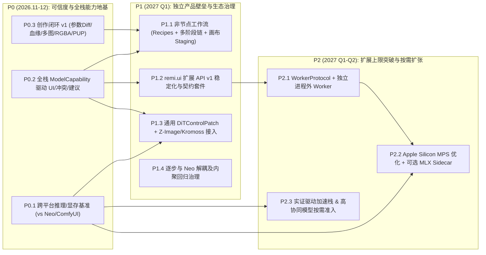

# Remi WebUI 战略定位与演进路线图（2026 Q4 – 2027 Q2）

> **修订日期**：2026-11-23（v2：结合竞品与架构深度审计完成战略重校准）  
> **仓库基线**：`remi` 分支 `8b1b749e`（已同步 Forge Neo 2.33 `5998fb39`，落地 `DiTCapability` 注册表及 Anima / MOSS-Image / Krea 2 / FLUX.3 Image Klein / Qwen-Image-2.1 五大 Tier-1 引擎）  
> **配套深度调研**：[competitive-and-architecture-research-2026-11.zh-CN.md](competitive-and-architecture-research-2026-11.zh-CN.md)（含七大竞品对标、代码级事实核验、分叉维护债审计与架构设计细节）  
> **核心定位**：面向 **8–24GB 消费级显卡与 Apple Silicon 统一内存** 的 **「零节点、冲突安全、专业参数可控的现代图像创作工作台」**——以传统 WebUI 的交互效率，提供接近专业创作工具的流程管理与阶段复用体验，同时保持 Anima 垂直护城河与无 Gradio 现代应用架构。

---

## 目录

- [一、战略校准：从“模型堆砌”转向“工作台壁垒 + 架构可持续性”](#一战略校准从模型堆砌转向工作台壁垒--架构可持续性)
- [二、路线图五大决策原则与硬约束（Guardrails）](#二路线图五大决策原则与硬约束guardrails)
- [三、架构演进总览](#三架构演进总览)
- [四、分阶段演进路线图（2026 Q4 – 2027 Q2）](#四分阶段演进路线图2026-q4--2027-q2)
  - [4.1 阶段 P0（2026.11–12）：基准可信度、能力驱动架构与旗舰创作闭环](#41-阶段-p020261112基准可信度能力驱动架构与旗舰创作闭环)
  - [4.2 阶段 P1（2027 Q1）：非节点式可组合工作流、扩展 API 稳定化与上游减债](#42-阶段-p12027-q1非节点式可组合工作流扩展-api-稳定化与上游减债)
  - [4.3 阶段 P2（2027 Q1–Q2）：Worker 进程隔离、Apple Silicon 跃升与模型按需准入](#43-阶段-p22027-q1q2worker-进程隔离apple-silicon-跃升与模型按需准入)
  - [4.4 明确延后与不做清单（Non-Goals）](#44-明确延后与不做清单non-goals)
- [五、优先级总表（投入产出比与验收标准 DoD）](#五优先级总表投入产出比与验收标准-dod)
- [六、工程守护清单与参考资料](#六工程守护清单与参考资料)

---

## 一、战略校准：从“模型堆砌”转向“工作台壁垒 + 架构可持续性”

在 `8b1b749e` 完成了无 Gradio React SPA 重构与五大 Tier-1 DiT 引擎深度适配后，结合对 ComfyUI（Subgraphs / Partial Execution / App Mode）、InvokeAI（Unified Canvas / Control Layers / Boards / Form Builder）、SwarmUI（多 GPU 后端池）、SD.Next 与 Apple MLX（`mflux`）的全面对标（详见[竞品与架构深度调研报告](competitive-and-architecture-research-2026-11.zh-CN.md)），本版路线图做出 **四项关键战略修正**：

1. **明确竞争边界，绝不进入 ComfyUI 的节点图主场**  
   ComfyUI 的核心壁垒是通用 DAG 与数千第三方节点生态，同时正通过 Templates、Subgraphs 与 App Mode 降低入门门槛；但其在**跨特性语义冲突管理、参数契约安全、零节点创作闭环**上存在结构性短板。Remi 的独立产品价值在于填补 **「既不强迫用户编排节点，也不把用户束缚在僵硬单次表单里」** 的空白空间。
2. **警惕“功能堆积陷阱”，重配研发资源比例**  
   仓库已累计 **`FORKED` 6 处、`DIVERGED` 32 个上游文件**。若继续把 80%+ 精力投入追逐新模型列表，Remi 会退化为高维护债务的“Forge Neo 美化版”。下一阶段明确将研发资源重配为 **「65% 平台与工作台护城河（基准、创作闭环、非节点工作流、能力驱动层、扩展契约、Worker 隔离、上游减债） + ≤35% 高 ROI 模型闭环」**。
3. **以客观基准建立技术可信度，告别“只有功能列表”**  
   Remi 的 UI 与前端性能已由 [ui-performance.md](ui-performance.md) 实测证明（启动快 2.75×、10k 图库 60/144 fps、UI 推理开销 ≤ 1%），但 **GPU/MPS 推理速度、峰值显存、模型切换与加速算法收益仍是实证空白**。将推理基准测试提至 **P0.1**，成为后续所有加速与模型工作的前置标尺。
4. **把 `remi.ui` 与 `DiTCapability` 打通为长期核心资产**  
   目前 [`backend/nn/dit_registry.py`](../../backend/nn/dit_registry.py) 只覆盖 5/17 引擎的后端钩子，尚未驱动前端面板可见性、事前冲突校验与结构化一键修正。完成 **`Model Adapter → Capability Declaration → Parameter Schema → Execution Plan`** 全链路收敛，是兼顾产品体验与长期可维护性的最大杠杆。

---

## 二、路线图五大决策原则与硬约束（Guardrails）

1. **硬件甜点区原则**：重投 **2B–12B** 可在 8–24GB 消费级 GPU 或 24–64GB Apple Silicon 流畅交互的模型；30B+ 超大模型仅采取“跟随上游合并 + 低成本套壳”，绝不抢跑重度自研。
2. **新模型准入闸门（Model Admission Gate）**：任何新增模型或模型深改立项前，须同时满足：① 符合硬件甜点区；② 全部规则沉淀于能力注册表 + 独立模块，上游共享文件改动 **≤ 3 行**；③ 确认上游 Forge Neo 短期（~30 天）不会原生合入相同改动；④ 随附实测基准数据、SPA 闭环与回归单测。
3. **逐步与 `neo` 解耦及内聚回归治理（In-Tree Decoupling Governance）**：
   - Remi 逐步与上游 `neo` 分支解耦，所有运行时缺陷修复与架构升级均在 Remi 仓内直接落地维护，**不向上游提交任何 Issue 或 PR**；
   - 通过 `tools/upstream_forks.py budget` 强制保障每一处共享来源运行时改动均具备磁盘可验证的回归固定测试（pinning test 存活率 100%）。
4. **实测驱动优化原则**：所有推理加速（Spectrum 扩展、TaylorSeer/MagCache、4-bit 量化、MPS 优化）必须基于统一基准套件输出速度 + 峰值显存 + 固定 seed 视觉指标（LPIPS/PSNR）数据，无实证收益不合入主干。
5. **端到端闭环交付原则**：任何后端能力必须同步交付 SPA 交互、双语（en / zh-CN）文案、自动生成契约（`openapi.json` / `schema.d.ts` / mock contract）与自动化测试，不留“只有改代码/看日志才知道”的半成品。

---

## 三、架构演进总览

---

## 四、分阶段演进路线图（2026 Q4 – 2027 Q2）

### 4.1 阶段 P0（2026.11–12）：基准可信度、能力驱动架构与旗舰创作闭环

#### P0.1 可独立复现的跨平台推理与显存基准套件（收益 5/5 · 成本 2/5）
- **解决痛点**：补齐与 [ui-performance.md](ui-performance.md) 对应的推理实证短板，用可复现数据回答“Remi 相对 Forge Neo / ComfyUI 到底快不快、省不省显存、长跑稳不稳”，并彻底根因定位 `tools/smoke_real.py` 遗留的历史 txt2img 像素漂移。
- **核心交付**：
  1. **基准工具链**（`tools/perf/bench_inference.py` + `docs/research/inference-performance.md`）：
     - 在相同硬件（NVIDIA CUDA & Apple Silicon MPS）、相同模型权重、精度、采样器、步数、分辨率与预热轮次下，标准化测量 **Remi vs Forge Neo vs ComfyUI** 的：冷加载耗时、热切模耗时、首图延迟、稳态步速（it/s）、峰值 VRAM / 统一内存、主机 RAM 峰值；
     - 覆盖 Remi 核心代表模型矩阵（**Anima 2B/Turbo、Qwen-Image-2.1、FLUX.3 Klein**）及优化开关矩阵（`BF16 / FP8 / INT8-ConvRot / GGUF`、`per-block compile`、`Spectrum SEA`、`Prefix KV Cache`、`NAG / APG / TCFG / DAVE / SPEED`），同步输出加速比、显存变化与 20-seed 视觉一致性指标（LPIPS / PSNR）；
  2. **队列长稳压测（Soak Test）**：连续执行 100 项混合队列任务（切模、img2img、中途中断、错误恢复），验证 RSS/VRAM 无阶梯泄漏、SQLite WAL 与文件清理稳定；
  3. **基线诊断**：根因排查并闭环 `tools/smoke_real.py` 的历史像素差异记录，确保每轮发布前具备可重复核验的客观基线。

#### P0.2 `DiTCapability` 升级至全栈能力驱动层（收益 5/5 · 成本 3.5/5）
- **解决痛点**：终结「非 Anima 模型加载时仍满屏显示 10+ Anima 面板」「`PresetArch` 与 `DiTCapability` 双轨分裂」「`workflow_advice` 仅事后打日志」「`modules/processing.py` 散落 15 处 `dynamic_args.*`」四大架构债。
- **核心交付**：
  1. **能力模型扩展**（[`backend/nn/dit_registry.py`](../../backend/nn/dit_registry.py)）：为 `DiTCapability` 补齐面向 UI 与执行层的声明字段（`capabilities` 能力集、`max_references`、`reference_slot_format`、`supports_rgba`、`default_sampling_profile` 等），建立与 [`modules_forge/presets.py`](../../modules_forge/presets.py) 的单一事实来源映射，逐步收敛 `processing.py` / `image_stitch.py` 中散落的模型名分支；
  2. **能力驱动的 `remi.ui` 面板可见性**（[`remi/core/tabs.py`](../../remi/core/tabs.py) + `webui/src/pages/generate/`）：为 `scripts.Script` 增加可选声明 `requires_capabilities`（首批覆盖全部 Anima 专项扩展与 DiT 专属面板），Schema 与 SPA 根据当前激活模型家族自动展示适用面板，并将不适用面板收纳折叠（附明确原因说明），彻底消除“开了开关却静默无效”；
  3. **事前冲突与结构化一键修正芯片**：将 `workflow_advice` 升级为结构化 `AdviceItem(code, severity, message, patch)`，接入 `/api/v2/rules/derive`；SPA 在提交前即提示配置冲突（如 Turbo + 30 步/CFG 5、RGBA + JPEG、参考图附带但 Reference 开关关闭）并提供**「一键修正参数」按钮**；Model Bar 同步展示模型元数据徽章（`Diffusers` / `INT8-ConvRot` / `FP8` / `NVFP4` / `GGUF` / `Turbo`）。

#### P0.3 旗舰创作闭环 v1：图库对比 Diff、血缘联动、多参考图/RGBA 与 FLUX.3 PUP（收益 4.5/5 · 成本 3/5）
- **解决痛点**：打通高频创作者每天都在用的“生成 → 对比调参 → 溯源复用 → 多图/透明编辑 → 扩写提示词”核心链路。
- **核心交付**：
  1. **对比器升级（参数 Diff）**（[`webui/src/features/library/CompareDialog.tsx`](../../webui/src/features/library/CompareDialog.tsx)）：在像素滑块/并排对比下方增加结构化 **Parameters Diff** 面板，高亮两张图在 Prompt、Negative、Seed、Model、Steps、CFG、Sampler、LoRA 权重及启用扩展上的精确差异，并支持“复制差异参数到当前表单”；
  2. **资产血缘与参考图直达**（[`remi/library.py`](../../remi/library.py) + [`webui/src/features/send-to/ResultActions.tsx`](../../webui/src/features/send-to/ResultActions.tsx)）：
     - 索引 `files.job_id`、`jobs.retry_of`、`init_img`、`upscale_from` 与 `ImageStitch` 引用关系，在 Lightbox / GalleryDetails 显示来源任务与衍生图链路，一键跳转父/子版本或复现源任务；
     - `Send to` 新增**「发送到参考图（`ImageStitch`）」**；多参考图列表升级编号徽章（按当前模型能力自动标注 `<image_1>` / `ref_image_0`）、拖拽排序与点击插入提示词光标处；
     - Lightbox 与输出预览新增 **RGBA 透明四色底板切换**（棋盘格 / 纯黑 / 纯白 / 绿幕）与 Alpha 保留全链路验证；
  3. **FLUX.3 多模态 + 本地 Prompt Upsampler（PUP）闭环**（[`remi/prompt_tools/translate.py`](../../remi/prompt_tools/translate.py) + [`backend/nn/flux3_layout.py`](../../backend/nn/flux3_layout.py)）：
     - 增强 OpenAI 兼容扩写接口支持附带当前启用的参考图（缩放限幅）、目标画幅与 JSON Builder BBox 草案，自动按当前加载模型家族匹配模板（无缝对接本地 llama.cpp / Ollama / MLX-LM / vLLM 或云端 VLM）；
     - 提供可选进程内量化 PUP 加载器（复用现有 `Qwen3.5` 栈，用后即释放显存），并在 SPA Prompt Editor 提供「扩写 → Diff 预览 → 一键采纳/撤回」交互。

---

### 4.2 阶段 P1（2027 Q1）：非节点式可组合工作流、扩展 API 稳定化与上游减债

#### P1.1 非节点式可组合工作流：Recipes、线性多阶段管线与画布 Staging（收益 5/5 · 成本 4/5）
- **解决痛点**：构建超越「Forge Neo 美化版」的独立产品壁垒——在不引入节点图的前提下，提供**参数配方复用、多阶段自动串联、改后段参数复用前段产物的“零节点局部重跑”**，以及向 InvokeAI 看齐的画布与图库创作体验。
- **核心交付**：
  1. **通用参数 Recipes（配方系统）**：泛化 `Anima Remi Presets` 为跨模型的一等公民 Recipe（存储在 SQLite，支持部分参数子集覆盖、适用模型能力标签、一键捕获当前差异参数、JSON 导入导出与分享），并在应用时自动经过 P0.2 冲突解析器校验；
  2. **线性多阶段任务链（`JobChain` / `StageRun`）与阶段缓存复用**：
     - 在 [`remi/jobs/store.py`](../../remi/jobs/store.py) 扩展轻量 `chains` 与 `stage_runs` 表，支持将 `Prompt Upsample → Base Generate → Refine (Inpaint / ADetailer / img2img) → Finish (Hires / PiD 4× / Extras)` 编排为可保存、可编辑的线性阶段列表；
     - 每个 Stage 持久化输出产物与输入签名哈希；当用户只调整下游 Stage 参数重跑时，自动复用上游未变更 Stage 的输出，跳过重复推理；
  3. **画布原地 Staging 与图库 Boards**：
     - 在 Konva 编辑器（`webui/src/canvas/`）引入**候选区（Staging Area）**：局部重绘可生成 1–4 张候选直接叠加在当前画布选区翻阅，确认后原地合并为新底图，不丢缩放视角与蒙版上下文；
     - Gallery 新增自定义 **Boards（项目/角色看板）**，支持将看板内精选图批量一键送入参考图列表或打包导出。

#### P1.2 `remi.ui` 扩展 API v1 稳定化与契约治理（收益 4/5 · 成本 3/5）
- **解决痛点**：把 `remi.ui` 从“内部重构框架”正式升级为可长期演化、第三方敢于基于其开发的稳定扩展平台。
- **核心交付**：
  1. **显式版本与 Manifest 契约**：引入 `REMI_API_VERSION = "1.0"` 与可选扩展清单 `remi-extension.json`（声明兼容 Remi API 版本范围、`requires_capabilities`、`requires_widgets`、作者/许可元数据），制定 SemVer 废弃与向后兼容政策；
  2. **运行时隔离与诊断中心**：在 Extensions 页面新增扩展健康诊断视图（加载耗时、错误计数、最近被跳过的 hook 警告、未适配脚本迁移指引），为 `@ui.action` 增加超时与异常边界保护，避免单个扩展拖垮整页表单或队列；
  3. **公开契约测试套件与富声明式控件补齐**：将 `tests/remi_port_harness.py` 提炼为稳定公开模块 `remi.testing`（附最小模板仓库与脚手架命令），同时补齐高频通用声明式组件（如键值表、轻量曲线、多图槽位配置），让 95% 扩展无需修改 React 源码即可拥有原生体验。

#### P1.3 通用 `DiTControlPatch`（`Fun-Controlnet-Union`）与 `Z-Image` / `Kromoss` 标准化接入（收益 4.5/5 · 成本 3/5）
- **解决痛点**：用 P0.2 全栈能力层与 P0.1 基准套件做真实大考——以“零核心侵入、全基准验收”的方式交付 2026 下半年最具生产力的单文件多条件控制与高效商用底座。
- **核心交付**：
  1. **通用 `DiTControlPatch` 抽象**（复用 [`anima_vace.py`](../../extensions-builtin/sd_forge_controlllite/lib_controllllite/anima_vace.py) 的 `control_blocks` 模式）：
     - 自动识别并按目标 DiT 家族过滤 `control_blocks.*` 权重；
     - 落地 **`Qwen-Image-2.1-Fun-Controlnet-Union`**（16 层偶数层零门控挂接 + 129 通道控制/结构化 Inpaint，安全联动 Prefix KV Cache / Spectrum / Compile）与 **`Z-Image-Turbo-Fun-Controlnet-Union`**；
  2. **`Z-Image` 全家桶（Base / Turbo / Omni / Edit）升级**：完全通过新版 `ModelCapability` 接入（Diffusers/Unsloth 加载、敏感层量化保护、跨步文本/RoPE 缓存、per-block compile、Spectrum 接缝与参考图管线），同步交付 `tests/test_remi_zimage.py` 与 P0.1 基准数据；
  3. **`MOSS-Image / lodestones/Kromoss` + 8 步 DMD2 LoRA 适配**：补齐结构化工作流建议（自动提示一键切至 `8 steps + CFG 1.0`）、加载核验与回归单测。

#### P1.4 运行时解耦与内聚回归治理专项（Progressive Neo Decoupling）（收益 4.5/5 · 成本 2/5）
- **解决痛点**：确立向独立代码库逐步演进的治理边界，不再受上游合并表面积束缚，同时保持 100% 可复现回归测试保护。
- **核心交付**：
  1. **全部修复在仓内独立闭环**：Remi 逐步与 Forge Neo `neo` 分支解耦，确定性修复与运行时增强直接在 Remi 内落地维护，**绝不向上游提交任何 Issue 或 PR**；
  2. **自动化固定测试审计门禁**：通过 `tools/upstream_forks.py budget` 核查每条共享来源改动分类（`remi-runtime-fix` / `remi-architecture-hook`）与磁盘 pinning test 100% 存活率；
  3. **按需选择性参考**：历史参考对比仅通过只读 diff 审查并在必要时附回归单测吸收。

---

### 4.3 阶段 P2（2027 Q1–Q2）：Worker 进程隔离、Apple Silicon 跃升与模型按需准入

#### P2.1 推理 Worker 进程隔离（`WorkerProtocol` + 独立子进程 Worker）（收益 5/5 · 成本 4/5）
- **解决痛点**：解除单进程主线程架构的扩展天花板，同时立刻改善单 GPU 桌面用户的故障自愈与高负载流畅度，并为 MLX Sidecar 与本机多 GPU 铺平统一协议。
- **核心交付**：
  1. **阶段 A — 控制面与推理面边界解耦**：引入 `RuntimeBridge` 收敛 `remi/server/routes/` 对 `shared.state` / `shared.sd_model` / `modules_forge.main_entry` 的直接内存访问；将 `JobResult`、实时进度与二进制预览流改造为可跨进程传输的纯数据协议（共享 `remi-data` 文件 ID + 本地 IPC）；
  2. **阶段 B — 可选独立子进程 Worker（`remi-worker`）**：默认保持向后兼容的进程内模式过渡，提供 `--worker-process`（成熟后转默认）启动受监管子进程：
     - CUDA OOM 死锁、MPS 驱动挂起或 C++ 扩展崩溃时，控制面捕获退出并自动重启 Worker，前端、队列与图库零中断；
     - 彻底分离 Web/图库/WS 事件循环与 Python 推理 GIL，消除高负载下的步间抖动；
     - 预留多 Worker 槽位接口（为后续“每 GPU 一 Worker”队列分发做准备，暂不引入复杂分布式集群调度）。

#### P2.2 Apple Silicon 体验跃升：MPS 热点优化 + 基于 `WorkerProtocol` 的可选 MLX Sidecar（收益 4/5 · 成本 3.5/5）
- **解决痛点**：缩小 Apple Silicon 上 PyTorch MPS 相对原生 MLX（`mflux`）的显存与速度代差，同时绝不污染 Forge PyTorch 核心代码。
- **核心交付**：
  1. **MPS 立即可落地优化**：基于 P0.1 基准数据，剖析并优化 [`backend/operations_mixed_precision.py`](../../backend/operations_mixed_precision.py) 与 [`backend/memory_management.py`](../../backend/memory_management.py) 在 MPS 上的反量化开销、多余同步点与统一内存回收抖动，明确 `torch.compile` 在 PyTorch MPS 上的安全白名单；
  2. **可选 MLX Sidecar Worker POC**：基于 P2.1 的 `WorkerProtocol`，验证以独立可选后端进程挂载 `mlx` / `mflux`（优先覆盖 FLUX.3 Klein / Qwen-Image-2.1 / Z-Image 的原生 4/6/8-bit 量化推理），前端 SPA、队列、图库、Recipe、PNG Info 与 API 保持 100% 一致。

#### P2.3 实证驱动的加速栈扩展与高协同模型按需准入（收益 3.5/5 · 成本 3/5）
- **前提约束**：全部受 **P0.1 基准数据** 与 **新模型准入闸门** 严格约束，宁缺毋滥。
- **候选池（按实测 ROI 择优推进）**：
  1. **加速与低比特生态**：
     - 将 `sd_forge_spectrum` 扩展至 `Z-Image` / `Wan 2.2` 等模型，并用 P0.1 基准横向评测 **TaylorSeer / MagCache** 相对 Spectrum SEA 的真实速度与 LPIPS 差值（仅在特定长步数/视频场景存在显著净胜时才作为可选预测模式合入）；
     - 随社区官方权重与 `svdq.py` 成熟，跟进 **SVDQuant（W4A4）** / Blackwell **NVFP4** 对旗舰模型的覆盖，同时坚持将 **GGUF** 保留为跨平台低显存一等公民（覆盖全量回归测试）；
  2. **高协同模型按需准入**：
     - **`ERNIE-Image`（8B Apache 2.0）**：在 `ModelCapability` 模板成熟后低成本升级，与 Z-Image 组成商用无忧双子星；
     - **`Bria Fibo 2.0`（8.1B + 4-step Edit Turbo）**：复用已有 `Qwen3-VL-4B` + `FLUX.2 VAE` + `JSON Builder`（扩展 VGL JSON Schema 模式，显式标注 CC BY-NC 4.0 协议）；
     - **Anima 生态持续护城河**：跟进 CircleStone Labs 官方新版本，并评估将阶段式 LoRA 调度、Regional 区域权重等 Anima 高阶控制思想抽象至通用 DiT；
  3. **前沿观察池（不提前重投入）**：
     - **`MiniMax-H3-Image`（33B）**：等待上游 Forge Neo 合并后低成本套壳能力声明；
     - **`Lightricks/LTX-2.5`（22B 同步音视频）**：仅在明确决定向音视频工作台扩张时另行立项。

---

### 4.4 明确延后与不做清单（Non-Goals）

| 方向 | 决策 | 核心原因 |
|---|---|---|
| **引入通用节点图编辑器** | **明确不做** | 投入产出比极低（收益 3/5 · 成本 5/5），正面撞击 ComfyUI 最深护城河且稀释 Remi「零节点专业工作台」定位；改用 **P1.1 Recipes + 线性多阶段管线与产物复用** 覆盖核心诉求 |
| **盲目追逐新模型数量竞赛** | **明确拒绝** | 持续堆砌模型会迅速推高 `DIVERGED` 维护债、拖垮核心架构；一切新模型须通过准入闸门与分叉债预算 |
| **`HunyuanImage-3.0`（~80B）** | **暂缓 / 不自研** | 显存体积远超消费级本地甜点区，重度依赖 W4A8/NF4 流式 CPU offload，交互体验与 ROI 远逊 2B–12B 旗舰 |
| **`Wan 2.5 / 2.6` 与云端闭源生图 API 代理** | **不做** | 官方未开源权重（仅云端 API），与本地优先、隐私可控定位冲突（仅在 Prompt Tools 保留可选 OpenAI 兼容文本/VLM 扩写） |
| **提前引入复杂分布式集群调度** | **暂缓** | 先在 P2.1 把单机进程外 Worker 的协议与故障自愈做稳，再自然演化至本机多 GPU，不过度设计 |
| **重写或恢复 Gradio 兼容层** | **永不回退** | 坚持无 Gradio 的 `remi.ui` + FastAPI + React SPA 架构红线 |

---

## 五、优先级总表（投入产出比与验收标准 DoD）

| 阶段 | 编号 | 事项 | 收益 / 成本 | 复用的现有核心资产 | 预估周期 | 关键验收标准（DoD） |
|---|---|---|---|---|---|---|
| **P0** | **P0.1** | 跨平台推理与显存基准套件（vs Forge Neo / ComfyUI） | **5/5 · 2/5** | `tools/perf/`、`smoke_real.py`、`ui-performance.md` 方法论 | 1–2 周 | ① `tools/perf/bench_inference.py` 可一键复现 CUDA/MPS 推理、显存与切模指标；② 归档对照 Neo/ComfyUI 实测报告 `docs/research/inference-performance.md`；③ 100-job 队列压测零内存/连接泄漏；④ 闭环 `smoke_real.py` 历史像素差异 |
| **P0** | **P0.2** | `DiTCapability` 升级至全栈能力驱动（UI 可见性 + 事前冲突 + 一键修正） | **5/5 · 3.5/5** | `dit_registry.py`、`remi/core/conflicts.py`、`presets.py` | 2 周 | ① Anima 等专属扩展通过 `requires_capabilities` 在非匹配模型下自动收纳；② `workflow_advice` 升级为结构化芯片支持一键修正；③ Model Bar 显示格式/变体徽章；④ 至少消除 50% `processing.py`/`image_stitch.py` 散落分支 |
| **P0** | **P0.3** | 旗舰创作闭环 v1（参数 Diff、血缘、多参考图/RGBA、FLUX.3 多模态 PUP） | **4.5/5 · 3/5** | `CompareDialog`、`library.py`、`image-list`、`flux3_layout.py`、`qwen35.py` | 2 周 | ① `CompareDialog` 支持结构化参数 Diff 与差异应用；② Lightbox 显示父子血缘与一键发送到参考图；③ 参考图 `<image_1>` 徽章/拖拽/插入 + RGBA 四色底板；④ 本地/多模态 PUP 支持带参考图与 BBox 扩写及 Diff 采纳 |
| **P1** | **P1.1** | 非节点式可组合工作流（Recipes + 线性多阶段链 + 画布 Staging + Boards） | **5/5 · 4/5** | `remi/jobs/store.py`、`remi/ui`、`webui/src/canvas/`、`library.py` | 3 周 | ① 跨模型 Recipes 增删改查与导入导出可用；② 2–4 阶段 `JobChain` 改动后段重跑时命中前段缓存产物；③ 画布支持原地 1–4 候选 Staging 合并；④ Gallery 支持自定义 Boards 与 Playwright e2e + axe 全绿 |
| **P1** | **P1.2** | `remi.ui` 扩展 API v1 稳定化与契约治理 | **4/5 · 3/5** | `remi/ui/`、`remi_port_harness.py`、`extensions_admin.py` | 2 周 | ① 落地 `REMI_API_VERSION`、`remi-extension.json` 与 SemVer 策略；② 公开 `remi.testing` 契约包与模板扩展；③ Extensions 页面上线健康诊断与 Action 超时隔离 |
| **P1** | **P1.3** | 通用 `DiTControlPatch`（`Fun-Controlnet-Union`）+ `Z-Image` / `Kromoss` 升级 | **4.5/5 · 3/5** | `anima_vace.py`、新版 `ModelCapability`、`lumina.py`、`moss_diffusers.py` | 2 周 | ① 单文件识别 Qwen-2.1 / Z-Image 8 条件 + 129ch Inpaint 且零门控恒等；② Z-Image 全家桶以 ≤3 行上游钩子完成接入；③ Kromoss + 8-step DMD2 提示与单测就绪；④ 通过 P0.1 基准验收 |
| **P1** | **P1.4** | 运行时解耦与内聚回归治理专项（Progressive Neo Decoupling） | **4.5/5 · 2/5** | `tools/upstream_forks.py`、`upstream-absorption.md` | 持续 | ① 所有共享来源修复直接在仓内维护（零上游 Issue/PR）；② `DIVERGED` 全部具备磁盘可验证的回归固定测试（100% 存活）；③ 全门禁 `tools/check.sh` 零回归 |
| **P2** | **P2.1** | 推理 Worker 进程隔离（`WorkerProtocol` + 单进程外 Worker） | **5/5 · 4/5** | `remi/jobs/queue.py`（DI 边界）、`services.py`、`realtime.py` | 3–4 周 | ① 控制面不再直读 `shared.state`/`sd_model`；② `--worker-process` 下模拟 Worker OOM/崩溃可自动恢复且队列不丢；③ 高负载下浏览器与 WS 步间抖动显著下降（以 `step_segments.py` 验证） |
| **P2** | **P2.2** | Apple Silicon MPS 优化 + 基于 `WorkerProtocol` 的可选 MLX Sidecar POC | **4/5 · 3.5/5** | `operations_mixed_precision.py`、`memory_management.py`、`WorkerProtocol` | 2–3 周 | ① 输出 MPS 优化前后吞吐与统一内存实测对比；② 产出基于 `WorkerProtocol` 的 MLX Sidecar 可运行原型与决策文档 |
| **P2** | **P2.3** | 实证驱动加速栈扩展 & 高协同模型按需准入（ERNIE / Fibo 2.0 / Anima 跟进） | **3.5/5 · 3/5** | `sd_forge_spectrum`、`svdq.py`、`JSON Builder`、`ModelCapability` | 按需迭代 | ① 任何新加速算法须在 P0.1 基准证明净收益；② 新模型严格满足准入闸门（≤3 行上游侵入 + 全量单测 + 许可提示清晰）；③ GGUF 全引擎回归绿灯 |

---

## 六、工程守护清单与参考资料

每次推进上述任一路线图项，合并前须满足以下 **7 条不可妥协基线**：

1. **能力单一入口**：新 DiT 能力、面板可见性、事前冲突与工作流建议统一声明于 [`backend/nn/dit_registry.py`](../../backend/nn/dit_registry.py) 与 `remi.ui`，共享架构接缝同步更新 [`docs/remi-architecture-notes.md`](../remi-architecture-notes.md)。
2. **解耦与回归固定规范**：Remi 逐步与 Forge Neo 解耦，不向上游提交任何 Issue 或 PR；任何共享来源文件改动须登记 [`tools/upstream_forks.py`](../../tools/upstream_forks.py) 与 [`docs/remi-webui/upstream-absorption.md`](../remi-webui/upstream-absorption.md) 并随附固定单测，同时保留已追踪文件的 CRLF 换行符（`tools/check_line_endings.py`）。
3. **基准与回归证据**：涉及推理、量化、加速或 Worker 调度的改动，必须附带可复现基准或 CPU/GPU 回归测试证据，禁止凭体感合并。
4. **契约自动生成不手改**：后端路由、设置或扩展参数变更后，重新生成 `openapi.json`、`schema.d.ts`、mock contract 与 settings contract。
5. **双语与可访问性**：新增服务端标签同步补齐 `localizations/zh_CN.json`，SPA 字符串同步补齐 `webui/src/locales/zh-CN.json`，视觉改动通过 `/ui-audit` 与 Playwright + axe 零违规检查。
6. **架构红线**：全仓零 `gradio` 导入（ruff `TID251`），单向分层符合 [`tests/test_remi_layers.py`](../../tests/test_remi_layers.py)，测试零 `ResourceWarning`（显式关闭 SQLite 连接）。
7. **全门禁原子提交**：合并前通过 `tools/check.sh --strict` 对应门禁，保持变更原子化、可回滚。

### 关键参考文档（仓库内）
- 竞品、架构与生态深度调研报告：[competitive-and-architecture-research-2026-11.zh-CN.md](competitive-and-architecture-research-2026-11.zh-CN.md)
- UI 与服务端性能实测报告：[ui-performance.md](ui-performance.md)
- Anima 生成期优化调研：[anima-generation-optimizations.md](anima-generation-optimizations.md)
- WebUI 架构总览：[architecture.md](../remi-webui/architecture.md) · 扩展开发指南：[extension-guide.md](../remi-webui/extension-guide.md)
- 架构接缝与权衡：[remi-architecture-notes.md](../remi-architecture-notes.md)
- 上游 Forge Neo 吸收规范：[upstream-absorption.md](../remi-webui/upstream-absorption.md) · 最近同步：[upstream-sync-2026-11-22.md](../upstream-sync-2026-11-22.md)
- 重构验收记分卡：[scorecard.md](../remi-webui/scorecard.md) · 前端设计系统：[frontend.md](../remi-webui/frontend.md)
